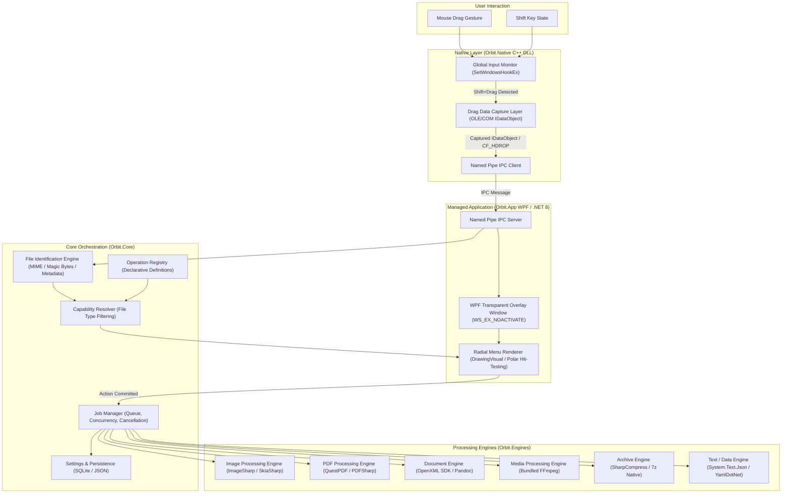
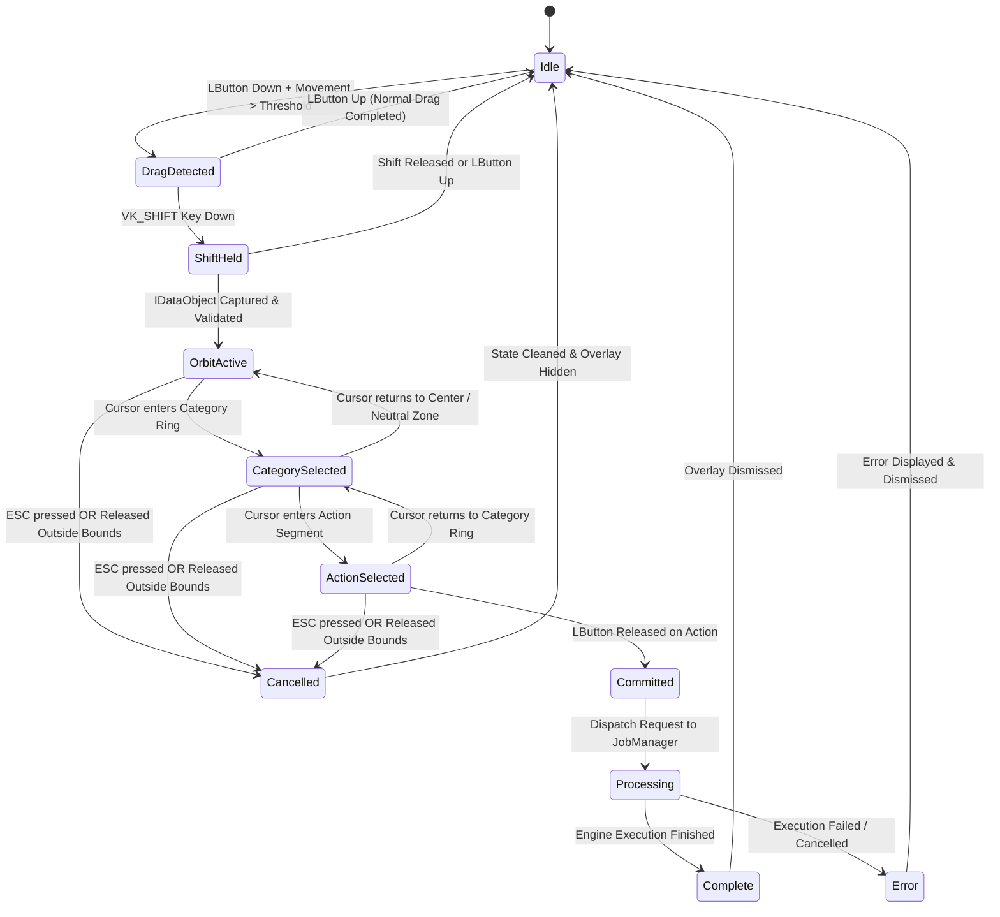

# Orbit — Technical Architecture

## 1. High-Level Architecture

Orbit is a system-wide, gesture-driven file operations utility designed for Windows 11 and Windows 10. The system monitors user interaction globally and activates a contextual radial menu when a user initiates a drag gesture while holding the `Shift` key. The application is divided into a high-performance native C++ layer for low-level OS hooks and OLE drag interception, and a modern .NET 8 WPF managed layer providing hardware-accelerated UI rendering, file identification, operation routing, and background processing.



### Component Overview

1. **Native Input Monitor (`Orbit.Native`)**: Runs low-overhead Win32 hooks (`WH_MOUSE_LL`, `WH_KEYBOARD_LL`) to observe drag motions and modifier keys globally without introducing input latency.
2. **Drag Data Capture Layer (`Orbit.Native`)**: Intercepts active drag-and-drop payloads via COM/OLE `IDataObject` extraction, decoding shell file lists (`CF_HDROP`, `CFSTR_SHELLIDLIST`).
3. **WPF Overlay Application (`Orbit.App`)**: High-performance, non-activating, per-monitor DPI-aware transparent window presenting the contextual radial menu directly under the cursor.
4. **File Identification Engine (`Orbit.Core`)**: Fast, multi-tiered file discriminator using path extensions, file header magic bytes, and deferred deep inspection.
5. **Operation Registry (`Orbit.Core`)**: Declarative repository cataloging all available system operations, parameter schemas, input/output constraints, and execution requirements.
6. **Capability Resolver (`Orbit.Core`)**: Matches inspected file characteristics against registered operation capabilities to populate contextually relevant menu segments.
7. **Processing Engines (`Orbit.Engines`)**: Modular execution engines isolating specific domains (raster images, vector/PDF, media transcoding, office documents, archives, structured text).
8. **Job Manager (`Orbit.Core`)**: Asynchronous scheduling queue handling task prioritization, progress tracking, cancellation tokens, error recovery, and collision handling.
9. **Settings & Persistence (`Orbit.Core`)**: Local storage engine preserving user preferences, key bindings, custom presets, and audit logs.

---

## 2. Technology Stack

| Layer / Responsibility | Technology Choice | Rationale & Alternatives Considered |
|---|---|---|
| **UI Framework** | **WPF on .NET 8 (C# 12)** | Mature Windows desktop framework with top-tier hardware acceleration, precise low-level Win32 interop (`HwndSource`), transparent window composition, and vector drawing (`DrawingVisual`). *Alternatives: WinUI 3 (less mature transparent overlay support), Avalonia (cross-platform unnecessary for Windows-only shell utility).* |
| **Native Integration** | **C++20 / Win32 API DLL** | Direct access to Windows kernel input hooks (`SetWindowsHookEx`), OLE/COM interfaces (`IDropTarget`, `IDataObject`), and sub-millisecond execution guarantees. |
| **Managed-Native Interop** | **P/Invoke + COM Interop + Named Pipes** | P/Invoke for lifecycle and hook configuration; Win32 Named Pipes with JSON payloads for asynchronous event dispatch; COM Interop for marshaling `IDataObject`. |
| **Image Processing** | **SixLabors.ImageSharp & SkiaSharp** | 100% managed, memory-safe, SIMD-accelerated raster operations without external runtime dependencies. SkiaSharp utilized where hardware rendering or SVG conversion is needed. *Alternative: System.Drawing (deprecated on modern .NET).* |
| **PDF Engine** | **PDFsharp & QuestPDF** | PDFsharp provides efficient low-level page extraction, merging, and document splitting; QuestPDF provides declarative layout generation for PDF conversions. *Alternative: iTextSharp (restrictive AGPL licensing).* |
| **Document Engine** | **OpenXML SDK & Pandoc (External CLI)** | Microsoft OpenXML SDK provides zero-dependency parsing and manipulation for DOCX, XLSX, and PPTX; Pandoc provides universal markup conversion (Markdown, HTML, RTF). |
| **Media Engine** | **FFmpeg (Bundled Process)** | Industry-standard audio/video transcoding, remuxing, stream extraction, and thumbnail generation invoked via piped background processes with progress stdout parsing. |
| **Archive Engine** | **SharpCompress & 7-Zip Native Interop** | SharpCompress provides pure managed decompression/compression across Zip, Tar, Gzip, and 7z; 7z native interop provides maximum compression ratios and multi-volume archive support. |
| **Text & Structured Data** | **System.Text.Json, YamlDotNet, Markdig** | High-throughput, zero-allocation serialization for JSON, YAML configuration parsing, and CommonMark Markdown compilation. |
| **Build & Tooling** | **MSBuild & dotnet CLI + MSVC (v143)** | Unified build pipeline supporting C++/CLI or dual C++ and C# compilation with automated dependency bundling. |
| **Installer & Packaging** | **WiX Toolset v4 / MSIX** | WiX provides enterprise-grade MSI creation with custom registry configuration for startup hooks; MSIX provides clean modern app isolation and auto-update support. |

---

## 3. The Native Layer (C++ DLL)

The native integration module (`Orbit.Native.dll`) is responsible for OS-wide input detection and active drag data capture. Because input hooks run synchronously within the system's message dispatch pipeline, the native layer is architected under strict zero-allocation, non-blocking principles.

### 3.1 Global Input Monitor

The input monitor utilizes Windows low-level hooks installed via `SetWindowsHookExW`:
- `WH_MOUSE_LL`: Observes low-level mouse messages (`WM_LBUTTONDOWN`, `WM_MOUSEMOVE`, `WM_LBUTTONUP`).
- `WH_KEYBOARD_LL`: Observes keyboard messages (`WM_KEYDOWN`, `WM_KEYUP`, `WM_SYSKEYDOWN`) to monitor `VK_SHIFT` state transitions.

```
+-------------------------------------------------------------------------+
|                         Windows Input Subsystem                         |
+-------------------------------------------------------------------------+
                                     |
               +---------------------+---------------------+
               |                                           |
               v                                           v
      [WH_MOUSE_LL Hook]                         [WH_KEYBOARD_LL Hook]
               |                                           |
               +---------------------+---------------------+
                                     |
                                     v
                        [HookProc Callback Dispatch]
                     * Time budget: < 1.0 ms
                     * Lock-free ring buffer push
                     * Immediate CallNextHookEx return
                                     |
                                     v
                      [Input State Machine Worker Thread]
```

#### Performance and Latency Constraints
1. **Low Latency (`< 1 ms`)**: The hook callback (`LowLevelMouseProc` / `LowLevelKeyboardProc`) must never block. It reads data from `MSLLHOOKSTRUCT` / `KBDLLHOOKSTRUCT`, updates atomic state flags, pushes an event to a lock-free circular queue, and immediately invokes `CallNextHookEx`.
2. **Hook Cleanup**: Hooks are uninstalled via `UnhookWindowsHookEx` during application shutdown or when the user disables gestures in settings. Hook integrity is monitored via a recurring watchdog timer.
3. **Distinguishing Orbit Shift from Native Windows Shift+Drag**:
   - In Windows Explorer, holding `Shift` while dragging forces a **Move** operation rather than a **Copy**.
   - If Orbit activates unconditionally on any Shift+drag, it could break standard Explorer drag-and-drop mechanics.
   - Orbit resolves this by:
     - Requiring an adjustable drag distance threshold (default: 16 pixels from mouse-down origin) before evaluating gesture activation.
     - Introducing an optional gesture modifier (e.g., holding `Shift` *after* the drag initiates, or double-tapping `Shift` during drag, configurable in preferences).
     - Allowing the native drag loop to remain fully intact: Orbit's overlay does not consume or cancel the underlying drag session unless an action is explicitly committed on the radial menu.

---

### 3.2 Drag Data Capture

Capturing the file payload (`IDataObject`) during an ongoing Windows drag operation is a core technical challenge because the drag source process (e.g., `explorer.exe`) owns the OLE `DoDragDrop` modal loop. Four architectural approaches were evaluated:

```
+---------------------------------------------------------------------------------------------------------+
|                                    DRAG CAPTURE ARCHITECTURAL MATRIX                                    |
+-------------------+------------------------------+---------------------------+--------------------------+
| Approach          | Mechanism                    | Advantages                | Primary Challenges       |
+-------------------+------------------------------+---------------------------+--------------------------+
| A. OLE Drop       | Registers transparent window | Native OLE compliance;    | Must not steal drop focus|
|    Target (Chosen)| as IDropTarget under cursor  | direct IDataObject access | or disrupt source cursor |
+-------------------+------------------------------+---------------------------+--------------------------+
| B. UI Automation  | Queries foreground element   | No window injection;      | High latency (>50ms);    |
|    + Selection    | selection via UIAutomation   | decoupled from drag loop  | fails in 3rd-party apps  |
+-------------------+------------------------------+---------------------------+--------------------------+
| C. Shell Ext      | In-process Explorer hook     | Deepest shell integration | Explorer stability risk; |
|    Handler        | via IShellExtInit            |                           | requires shell restart   |
+-------------------+------------------------------+---------------------------+--------------------------+
| D. Clipboard      | Intercepts synthetic         | Simple fallback           | Many drag sources do not |
|    Hybrid         | clipboard formats            |                           | mirror data to clipboard |
+-------------------+------------------------------+---------------------------+--------------------------+
```

#### Approach A: OLE Drop Target Registration (Primary Architecture)
- When a `Shift + Drag` gesture is confirmed, Orbit positions a transparent drop target window directly under the cursor.
- The window is registered via `RegisterDragDrop` implementing the COM interface `IDropTarget`.
- As the cursor moves over the window, Windows calls `IDropTarget::DragEnter(IDataObject* pDataObj, ...)`.
- Orbit immediately inspects `pDataObj` for supported clipboard formats:
  - `CF_HDROP`: Standard array of null-terminated wide-character file paths.
  - `CFSTR_SHELLIDLIST` (`Shell IDList Array`): Explorer shell PIDLs for virtual folders, zip files, or network items.
  - `CFSTR_FILEDESCRIPTORW` / `CFSTR_FILECONTENTS`: Stream payloads dragged directly from applications such as Outlook or zip archives.
- **Handling Drag Loop Continuity**: Orbit returns `DROPEFFECT_NONE` during preview hover so Explorer does not believe a drop has occurred. Only when the user commits an action on a radial segment does Orbit either accept the drop (`DROPEFFECT_COPY`) or signal the managed application to process the extracted file paths directly.

```cpp
// Orbit.Native: Extracting CF_HDROP from IDataObject
HRESULT ExtractFilePaths(IDataObject* pDataObject, std::vector<std::wstring>& outPaths) {
    FORMATETC fmt = { CF_HDROP, nullptr, DVASPECT_CONTENT, -1, TYMED_HGLOBAL };
    STGMEDIUM stg;
    HRESULT hr = pDataObject->GetData(&fmt, &stg);
    if (SUCCEEDED(hr)) {
        HDROP hDrop = static_cast<HDROP>(GlobalLock(stg.hGlobal));
        if (hDrop) {
            UINT fileCount = DragQueryFileW(hDrop, 0xFFFFFFFF, nullptr, 0);
            for (UINT i = 0; i < fileCount; ++i) {
                UINT len = DragQueryFileW(hDrop, i, nullptr, 0);
                std::wstring path(len, L'\0');
                DragQueryFileW(hDrop, i, &path[0], len + 1);
                outPaths.push_back(path);
            }
            GlobalUnlock(stg.hGlobal);
        }
        ReleaseStgMedium(&stg);
    }
    return hr;
}
```

#### Approach B: UI Automation & Selection (Fallback Architecture)
- If the drop target cannot acquire the `IDataObject` (for example, in sandboxed or elevated applications running with UAC boundaries), Orbit falls back to `IUIAutomation`.
- Orbit resolves the window handle under the cursor using `WindowFromPoint`, queries the corresponding `IUIAutomationElement`, and reads the `SelectionPattern` or `SelectionItemPattern` to extract selected file names from the active Explorer view.

**Recommendation**: Orbit deploys **Approach A** as its primary extraction engine. If `DragEnter` is not received within 150ms of gesture recognition, Orbit seamlessly triggers **Approach B** as a non-intrusive fallback.

---

### 3.3 State Machine

The interaction cycle is governed by a deterministic state machine implemented in the native layer to eliminate race conditions.



#### State Transition Specifications
1. **Idle**: Hooks active; cursor and keyboard monitored; zero UI visible.
2. **DragDetected**: Left mouse button held; cursor displacement exceeds 16px from click coordinate.
3. **ShiftHeld**: `VK_SHIFT` is pressed during active drag. Triggers transparent drop-target placement.
4. **OrbitActive**: `IDataObject` successfully read; overlay rendered at cursor coordinates with initial category ring.
5. **CategorySelected**: User moves cursor into a radial category slice (e.g., *Convert* or *Optimize*); outer action ring expands.
6. **ActionSelected**: User hovers over an actionable leaf node (e.g., *Convert to WebP*); visual highlight and parameter hint rendered.
7. **Committed**: Left mouse button released while hovering over a valid action segment. OLE drag loop dismissed or accepted; execution request dispatched to `JobManager`.
8. **Cancelled**: User presses `ESC`, releases mouse button outside active radial segments, or releases `Shift` before selecting an action. Overlay fades out; original drag operation restores unmodified.

---

## 4. WPF Overlay Window

The user interface presentation relies on a dedicated WPF overlay window designed to float above all system windows without interfering with user focus or OS shell behaviors.

```
+------------------------------------------------------------------------------------+
|                                WPF Overlay Window                                  |
|                                                                                    |
|  * WindowStyle = WindowStyle.None                                                  |
|  * AllowsTransparency = true                                                       |
|  * Topmost = true                                                                  |
|  * ShowInTaskbar = false                                                           |
|  * Background = Brushes.Transparent                                                |
|                                                                                    |
|  Win32 Extended Window Styles (WS_EX):                                             |
|  +------------------------------------------------------------------------------+  |
|  | WS_EX_NOACTIVATE  | Prevents window from stealing keyboard/input focus       |  |
|  | WS_EX_TOOLWINDOW   | Suppresses appearance in Alt+Tab and taskbar            |  |
|  | WS_EX_TOPMOST      | Maintains Z-order positioning above active drag windows |  |
|  +------------------------------------------------------------------------------+  |
|                                                                                    |
+------------------------------------------------------------------------------------+
```

### Focus and Input Integrity
To avoid breaking the drag source's active modal loop, the overlay window must **never take focus**.
1. **`WS_EX_NOACTIVATE` Style**: Applied via `GetWindowLongPtr` and `SetWindowLongPtr` inside the `OnSourceInitialized` override.
2. **`WM_MOUSEACTIVATE` Handling**: Hooked via `HwndSource.AddHook`; intercepts `WM_MOUSEACTIVATE` and returns `MA_NOACTIVATE` (`0x0003`), informing Windows that clicks on this window must not activate it.
3. **Multi-Monitor and Per-Monitor V2 DPI Awareness**:
   - The overlay application declares `<dpiAwareness>PerMonitorV2</dpiAwareness>` in its application manifest.
   - When positioning the radial menu, cursor coordinates obtained via `GetCursorPos` (physical pixels) are converted to device-independent units (DIPs) using the monitor's specific DPI scale matrix retrieved via `VisualTreeHelper.GetDpi(this)` or `GetDpiForMonitor`.
   - Bounds-checking prevents the radial menu from clipping outside screen edges, shifting inward dynamically if spawned near monitor borders.

---

## 5. The Radial Menu Renderer

The radial menu is rendered via a custom WPF control utilizing low-level `DrawingVisual` objects or SkiaSharp surface contexts, ensuring a sustained 120+ FPS animation rate with low CPU overhead.

```
                           [ Outer Ring: Actions ]
                        /                             \
                       /    [ Middle Ring: Categories ] \
                      /   /                             \ \
                     |   |       [ Inner Ring ]          | |
                     |   |     +----------------+        | |
                     |   |     |     Cancel     |        | |
                     |   |     |    (Dismiss)   |        | |
                     |   |     +----------------+        | |
                     |   |                               | |
                      \   \                             / /
                       \    \                         / /
                        \                             /
```

### Ring Geometry and Segments
The menu is organized into three concentric zones:
1. **Inner Ring (Radius: 0px – 48px)**: Central dead-zone featuring a dismiss icon. Releasing the mouse button here cancels the interaction cleanly.
2. **Middle Ring (Radius: 49px – 140px)**: Primary category segments (e.g., *Convert*, *Edit*, *Optimize*, *Secure*, *Extract*). Segments are distributed evenly across $360^\circ$ or grouped into weighted angular arcs based on file relevance.
3. **Outer Ring (Radius: 141px – 240px)**: Action leaves corresponding to the currently hovered category. Revealed dynamically with a smooth scale-and-fade transition.

### Polar Coordinate Hit-Testing
The renderer detects segment interaction using polar coordinates relative to the menu center $(x_0, y_0)$:

$$\Delta x = x - x_0, \quad \Delta y = y - y_0$$

$$r = \sqrt{\Delta x^2 + \Delta y^2}$$

$$\theta = \left(\operatorname{atan2}(\Delta y, \Delta x) \cdot \frac{180}{\pi} + 360\right) \pmod{360}$$

- **Hysteresis and Angular Dead-Bands**: To avoid visual jitter when crossing boundaries, each segment boundary includes a $1.5^\circ$ angular hysteresis dampener and a 4px radial threshold buffer before switching active selection states.

### Visual Aesthetics and Theme
- **Color Palette**: Dark theme matching modern Windows 11 aesthetics.
  - Background Fill: `#1E1E24` with $85\%$ alpha (`#D91E1E24`) incorporating acrylic blur (`SetWindowCompositionAttribute` / DWM backdrop brush).
  - Segment Hover Fill: `#2D2D38` with subtle border illumination.
  - Accent / Selection Highlight: Vibrant Amber/Orange (`#FF8C00` / `#FFA726`).
  - Typography: Segoe UI Variable Display for headers, Segoe Fluent Icons for glyphs.
- **Animations**: Exponential ease-out (`CubicEase` with `EasingMode.EaseOut`, duration 120ms) for segment hover expansions and glow transitions.

---

## 6. File Identification Engine

The File Identification Engine resolves the underlying data type, security characteristics, and capabilities of dragged payloads. Identification occurs through a progressive four-tier pipeline, ensuring immediate UI responsiveness.

```
[ Dragged File Paths ]
         |
         v
+-------------------------------------------------------------+
| Tier 1: Extension-Based Fast Resolution (< 1 ms)            |
| Resolves preliminary FileFamily and known extensions        |
+-------------------------------------------------------------+
         |
         v
+-------------------------------------------------------------+
| Tier 2: Magic Byte Signature Verification (1-5 ms)          |
| Reads initial 16-512 bytes; checks file signature database  |
+-------------------------------------------------------------+
         |
         v
+-------------------------------------------------------------+
| Tier 3: MIME Type & Container Normalization (5-10 ms)       |
| Resolves standardized IANA MIME types and container formats  |
+-------------------------------------------------------------+
         |
         v
+-------------------------------------------------------------+
| Tier 4: Deferred Deep Inspection (Asynchronous / On-Demand) |
| Extracts image dimensions, EXIF, PDF pages, audio codecs    |
+-------------------------------------------------------------+
```

### Data Model

```csharp
namespace Orbit.Core.Models;

public enum FileFamily
{
    Unknown = 0,
    RasterImage,
    VectorImage,
    Document,
    Spreadsheet,
    Presentation,
    Pdf,
    Audio,
    Video,
    Archive,
    SourceCode,
    StructuredData,
    PlainText
}

public record FileIdentity
{
    public required string FilePath { get; init; }
    public required string Extension { get; init; }
    public required string MimeType { get; init; }
    public required FileFamily Family { get; init; }
    public required long FileSize { get; init; }
    public Dictionary<string, object> Metadata { get; init; } = new();
    public bool IsReadable { get; init; }
    public bool IsEncrypted { get; init; }
}
```

### Detection Strategy
1. **Tier 1 (Extension Lookup)**: Maps extensions (`.png`, `.pdf`, `.docx`) against a high-speed hash map. Completes in $< 0.1\text{ ms}$ to allow the radial menu to render category skeletons immediately.
2. **Tier 2 (Magic Bytes)**: Validates actual file headers against known byte sequences (e.g., `89 50 4E 47 0D 0A 1A 0A` for PNG, `25 50 44 46` for PDF, `50 4B 03 04` for Zip/Office containers) to prevent extension spoofing or incorrect engine routing.
3. **Tier 3 (MIME Resolution)**: Unifies extensions and magic bytes into standardized MIME identifiers (e.g., `image/webp`, `application/pdf`, `application/vnd.openxmlformats-officedocument.wordprocessingml.document`).
4. **Tier 4 (Deferred Deep Inspection)**: Expensive operations (parsing video duration via FFprobe, reading PDF page count, reading EXIF tags) are executed in a background thread only when the user hovers over a category requiring that metadata.

---

## 7. Operation Registry

The Operation Registry provides a centralized, declarative system describing all available operations, supported input/output formats, batch capabilities, and execution parameters.

### Data Models

```csharp
namespace Orbit.Core.Operations;

public enum OperationCategory
{
    Convert,
    Edit,
    Annotate,
    Optimize,
    Organize,
    Extract,
    Secure,
    Analyze,
    Create,
    Share
}

public record OperationDefinition
{
    public required string Id { get; init; }
    public required string Label { get; init; }
    public required string Description { get; init; }
    public required OperationCategory Category { get; init; }
    public required string[] InputFormats { get; init; }
    public required string[] OutputFormats { get; init; }
    public bool SupportsBatch { get; init; }
    public bool ModifiesOriginal { get; init; }
    public bool RequiresWorkspace { get; init; }
    public bool RequiresConfirmation { get; init; }
    public required string EngineId { get; init; }
    public required string IconGlyph { get; init; }
    public string? KeyboardShortcut { get; init; }
}
```

### Declarative Operation Catalog (Sample Excerpt)

```json
[
  {
    "Id": "image.convert.webp",
    "Label": "Convert to WebP",
    "Description": "Convert raster images to modern compressed WebP format",
    "Category": "Convert",
    "InputFormats": [ "image/png", "image/jpeg", "image/bmp", "image/tiff" ],
    "OutputFormats": [ "image/webp" ],
    "SupportsBatch": true,
    "ModifiesOriginal": false,
    "RequiresWorkspace": false,
    "RequiresConfirmation": false,
    "EngineId": "ImageEngine",
    "IconGlyph": "\uE8B9"
  },
  {
    "Id": "pdf.optimize.compress",
    "Label": "Compress PDF",
    "Description": "Reduce PDF file size by downsampling images and removing unreferenced objects",
    "Category": "Optimize",
    "InputFormats": [ "application/pdf" ],
    "OutputFormats": [ "application/pdf" ],
    "SupportsBatch": true,
    "ModifiesOriginal": false,
    "RequiresWorkspace": false,
    "RequiresConfirmation": false,
    "EngineId": "PdfEngine",
    "IconGlyph": "\uE72D"
  },
  {
    "Id": "media.extract.audio",
    "Label": "Extract Audio (MP3)",
    "Description": "Extract audio stream from video file into high-quality MP3",
    "Category": "Extract",
    "InputFormats": [ "video/mp4", "video/x-matroska", "video/quicktime", "video/x-msvideo" ],
    "OutputFormats": [ "audio/mpeg" ],
    "SupportsBatch": true,
    "ModifiesOriginal": false,
    "RequiresWorkspace": false,
    "RequiresConfirmation": false,
    "EngineId": "MediaEngine",
    "IconGlyph": "\uE8D6"
  }
]
```

### Capability Resolver Algorithm
The `CapabilityResolver` maps a set of input files $\mathcal{F} = \{f_1, f_2, \dots, f_n\}$ against all registered operations $\mathcal{O}$:
1. For each operation $o \in \mathcal{O}$:
   - If $|\mathcal{F}| > 1$ and $o.\text{SupportsBatch} == \text{false}$, exclude $o$.
   - Check if $\forall f \in \mathcal{F}, f.\text{MimeType} \in o.\text{InputFormats}$. If true, mark $o$ as **Fully Supported**.
   - If $|\mathcal{F}| > 1$ and only a subset matches, mark $o$ as **Partial** or exclude based on user preference.
2. Group matching operations by `OperationCategory`.
3. Remove empty categories from the radial menu.
4. Calculate category angular weights proportional to the number of available actions.

---

## 8. Processing Engine Architecture

All processing tasks are executed by modular processing engines implementing a common interface. Engines are isolated from the UI layer and execute inside the `JobManager` infrastructure.

### Engine Interface

```csharp
namespace Orbit.Core.Engines;

public record EngineCapabilities(
    string EngineId,
    string[] SupportedInputMimes,
    string[] SupportedOutputMimes,
    bool SupportsInPlaceModification,
    bool RequiresHardwareAcceleration
);

public record OperationRequest(
    Guid JobId,
    string OperationId,
    IReadOnlyList<string> SourceFilePaths,
    string OutputDirectory,
    Dictionary<string, object> Parameters
);

public record OperationProgress(
    Guid JobId,
    double Percentage,
    string CurrentItemName,
    int ItemsCompleted,
    int TotalItems,
    string StatusMessage
);

public record OperationResult(
    Guid JobId,
    bool Success,
    IReadOnlyList<string> OutputFiles,
    TimeSpan ElapsedTime,
    string? ErrorMessage = null,
    Exception? Exception = null
);

public interface IProcessingEngine
{
    string EngineId { get; }
    string DisplayName { get; }
    bool IsAvailable { get; }
    Task<EngineCapabilities> GetCapabilitiesAsync();
    Task<OperationResult> ExecuteAsync(
        OperationRequest request, 
        IProgress<OperationProgress> progress, 
        CancellationToken ct
    );
    Task<bool> ValidateAsync(OperationRequest request);
}
```

### Engine Registry Table

| Engine | Responsibility | Key Libraries & Tools | Sandboxing / Isolation |
|---|---|---|---|
| **ImageEngine** | Raster image conversion, resizing, lossless/lossy compression, orientation fix, EXIF stripping, palette reduction. | SixLabors.ImageSharp, SkiaSharp | In-process managed memory sandbox with maximum pixel dimension limits (e.g., max 100 MP to prevent decompression bombs). |
| **PdfEngine** | Page splitting, merging, reordering, rotation, flattening annotations, image downsampling, text extraction. | PDFsharp, QuestPDF, SkiaSharp | In-process managed execution; file locking verification before modification. |
| **DocumentEngine** | Office document conversion (DOCX/XLSX/PPTX to PDF/Markdown), metadata cleaning, plaintext extraction. | OpenXML SDK, Pandoc CLI | Managed OpenXML SDK for direct manipulation; Pandoc executed in restricted worker process with restricted environment variables. |
| **MediaEngine** | Audio/Video transcoding, container remuxing, audio track extraction, video clipping, GIF generation, thumbnail generation. | Bundled FFmpeg & FFprobe (x64) | Out-of-process execution; stdout/stderr pipe streaming; process priority set to `BelowNormalPriority`. |
| **ArchiveEngine** | Archive inspection, folder packaging, decompression, encrypted archive handling, multi-volume extraction. | SharpCompress, 7-Zip native DLL | Path traversal validation (`Zip Slip` defense); memory-buffered decompression limit. |
| **TextDataEngine** | JSON/YAML/XML/CSV formatting, validation, syntax minification, schema checking, unified diff generation. | System.Text.Json, YamlDotNet, CsvHelper | Pure in-memory streaming with max file size threshold (e.g., 250 MB). |

---

## 9. Job Manager

The `JobManager` manages the execution lifecycle of all user-committed operations. It decouples the radial menu UI from heavy file processing operations.

```
+-----------------------------------------------------------------------------------+
|                                   Job Manager                                     |
+-----------------------------------------------------------------------------------+
                                          |
                        +-----------------+-----------------+
                        |                                   |
                        v                                   v
             [CPU-Bound Worker Queue]             [I/O-Bound Worker Queue]
             * Image conversions                  * Large archive extraction
             * FFmpeg transcoding                 * Multi-file copy / move
             * Max Concurrency: Logical Cores - 1  * Max Concurrency: 2 (prevent thrash)
                        |                                   |
                        +-----------------+-----------------+
                                          |
                                          v
                              [Execution & Progress Bus]
                               * IProgress<OperationProgress>
                               * CancellationTokenSource
                               * Output collision resolution
                               * SQLite persistent history
```

### Core Responsibilities
1. **Queueing & Concurrency**:
   - Separate execution lanes for CPU-bound tasks (e.g., ImageSharp conversions, media transcoding) and I/O-bound tasks (e.g., unpacking large zip archives).
   - Configurable maximum concurrency to prevent system unresponsiveness during intensive batch operations.
2. **Progress & Telemetry**:
   - Granular progress reporting via `IProgress<OperationProgress>` feeding into an unobtrusive Windows notification or floating task-tray progress pill.
   - Per-item progress and aggregate batch calculation.
3. **Cancellation & Graceful Abort**:
   - Every job receives a `CancellationToken`. When cancelled, processes (such as FFmpeg) receive `SIGTERM` or process-tree kill, and partially generated temporary files are cleaned up immediately.
4. **Output Collision Strategies**:
   - `AutoRename`: Appends an incremental counter (e.g., `Document (1).pdf`).
   - `Overwrite`: Replaces the destination file after atomic temp-write.
   - `Prompt`: Displays an unobtrusive prompt toast for user resolution.
5. **Persistence**:
   - Operational audit log and recent job history persisted to a local SQLite database (`orbit_history.db`).

---

## 10. IPC Between Native and Managed

Because `Orbit.Native.dll` operates in low-level Win32 hook contexts and `Orbit.App` operates in the .NET 8 runtime, an efficient, resilient Inter-Process Communication (IPC) boundary is established.

```
+--------------------------+                         +--------------------------+
|     Orbit.Native.dll     |                         |        Orbit.App         |
|  (Win32 / C++ Native)    |                         |     (WPF / .NET 8)       |
+--------------------------+                         +--------------------------+
             |                                                     |
             |  1. P/Invoke Initialization                         |
             |<----------------------------------------------------|
             |     - RegisterHooks(pipeHandle, config)             |
             |                                                     |
             |  2. Named Pipe Connection: \\.\pipe\OrbitNative_{pid}
             |====================================================>|
             |                                                     |
             |  3. Event Stream (JSON over Named Pipe)             |
             |---------------------------------------------------->|
             |     - GestureStarted { x, y, timestamp }            |
             |     - FileDataCaptured { paths, formats, source }   |
             |     - GestureCancelled { reason }                   |
             |                                                     |
             |  4. Control Messages                                |
             |<----------------------------------------------------|
             |     - DismissOverlay / ResetHooks                   |
```

### IPC Protocol Specification
- **Transport**: Windows Local Named Pipe (`\\.\pipe\OrbitNative_{PID}`) configured for duplex byte-stream mode with asynchronous overlapped I/O.
- **Framing**: 4-byte little-endian message length prefix followed by UTF-8 encoded JSON payload.

#### Message Schemas

**`GestureStarted` (Native $\rightarrow$ Managed)**
```json
{
  "type": "GestureStarted",
  "timestamp": 1729423470123,
  "cursorPosition": { "x": 1280, "y": 720 },
  "modifierKeys": [ "Shift" ]
}
```

**`FileDataCaptured` (Native $\rightarrow$ Managed)**
```json
{
  "type": "FileDataCaptured",
  "sourceHandle": "0x000204AE",
  "dropEffect": "Copy",
  "files": [
    "C:\\Users\\User\\Documents\\Report.docx",
    "C:\\Users\\User\\Documents\\Financials.xlsx"
  ],
  "availableFormats": [ "CF_HDROP", "CFSTR_SHELLIDLIST" ]
}
```

**`GestureCancelled` (Native $\rightarrow$ Managed)**
```json
{
  "type": "GestureCancelled",
  "reason": "EscapePressed",
  "timestamp": 1729423472450
}
```

**`ExecuteOperation` (Managed $\rightarrow$ Native / JobManager)**
```json
{
  "type": "ExecuteOperation",
  "operationId": "image.convert.webp",
  "targetFiles": [ "C:\\Users\\User\\Pictures\\photo.png" ],
  "parameters": { "quality": 85, "keepExif": false }
}
```

---

## 11. Project Structure

The Orbit solution is organized into distinct, single-responsibility assemblies and modules:

```
orbit/
├── src/
│   ├── Orbit.Native/                  # C++20 Win32 DLL
│   │   ├── include/
│   │   │   ├── InputHookManager.h     # SetWindowsHookEx lifecycle & state machine
│   │   │   ├── DragCaptureTarget.h    # OLE IDropTarget implementation
│   │   │   ├── DataObjectParser.h     # CF_HDROP & Shell PIDL decoding
│   │   │   └── PipeServer.h           # Win32 Named Pipe client
│   │   ├── src/
│   │   │   ├── InputHookManager.cpp
│   │   │   ├── DragCaptureTarget.cpp
│   │   │   ├── DataObjectParser.cpp
│   │   │   ├── PipeServer.cpp
│   │   │   └── dllmain.cpp
│   │   └── Orbit.Native.vcxproj
│   │
│   ├── Orbit.Core/                    # .NET 8 Class Library (Architecture Core)
│   │   ├── Models/                    # FileIdentity, FileFamily, Job models
│   │   ├── Identification/            # FileIdentificationEngine, MagicBytes DB
│   │   ├── Operations/                # OperationRegistry, CapabilityResolver, OpDefinitions
│   │   ├── Engines/                   # IProcessingEngine, OperationRequest, EngineCapabilities
│   │   ├── Jobs/                      # JobManager, WorkerQueue, CollisionResolver
│   │   ├── Storage/                   # SQLite history, user presets, settings store
│   │   └── Orbit.Core.csproj
│   │
│   ├── Orbit.App/                     # .NET 8 WPF Application (Presentation)
│   │   ├── Views/                     # OverlayWindow, SettingsWindow, ToastNotification
│   │   ├── Controls/                  # RadialMenuControl, SegmentVisual, GlowingBorder
│   │   ├── ViewModels/                # OverlayViewModel, RadialSegmentViewModel
│   │   ├── Interop/                   # NativeBridge (P/Invoke), PipeClient, Win32Helper
│   │   ├── Resources/                 # DarkTheme.xaml, FluentIcons.xaml, Converters
│   │   ├── App.xaml
│   │   ├── App.xaml.cs
│   │   └── Orbit.App.csproj
│   │
│   └── Orbit.Engines/                 # .NET 8 Processing Engine Implementations
│       ├── Image/                     # ImageSharp & SkiaSharp processing
│       ├── Pdf/                       # PDFsharp & QuestPDF processing
│       ├── Document/                  # OpenXML & Pandoc runners
│       ├── Media/                     # Bundled FFmpeg execution & stream parsing
│       ├── Archive/                   # SharpCompress & 7z extraction/packaging
│       ├── Text/                      # JSON/YAML/Diff processing
│       └── Orbit.Engines.csproj
│
├── tests/
│   ├── Orbit.Core.Tests/              # Unit tests for identification, registry, resolver
│   ├── Orbit.Engines.Tests/           # Unit tests for image/pdf/media engines
│   └── Orbit.Integration.Tests/       # End-to-end simulated drag-to-commit tests
│
├── tools/
│   └── ffmpeg/                        # Bundled standalone FFmpeg & FFprobe binaries
│       ├── bin/
│       │   ├── ffmpeg.exe
│       │   └── ffprobe.exe
│       └── LICENSE
│
├── docs/
│   ├── PRODUCT_SPEC.md                # Functional specifications & user scenarios
│   ├── ARCHITECTURE.md                # System technical architecture (this document)
│   ├── NATIVE_INTEGRATION.md          # Deep dive into hooks, OLE, and Win32 interop
│   └── DEVELOPMENT.md                 # Setup, debugging, build pipelines, contribution
│
├── Orbit.sln                          # Master Visual Studio Solution
├── README.md                          # Repository overview & quickstart
└── .gitignore                         # Git exclusion rules
```

---

## 12. Acceptance Test Criteria

To guarantee system stability, user trust, and non-interference with standard Windows shell operations, the following end-to-end acceptance test is non-negotiable:

```
[ Explorer File Selection ]
           |
           v
[ Initiate Left-Click Drag ]
           |
           v
[ Depress & Hold Shift Key ]
           |
           v
[ Verify: Orbit Overlay Appears at Cursor ]
  * Original Explorer drag shadow remains valid
  * Zero flickering or window focus theft
           |
           +---------------------------------------+
           |                                       |
           v                                       v
[ Path 1: Commit Action ]              [ Path 2: Cancel Gesture ]
  * Hover over category slice            * Press ESC OR release outside
  * Radial sub-actions expand            * Overlay dismisses smoothly
  * Release mouse on target action       * Explorer drag remains uninterrupted
  * Radial overlay dismisses             * Source file remains unmodified
  * Output file created correctly        * Normal move/copy remains available
  * Notification confirms completion
```

### Detailed Acceptance Test Suite

| Test ID | Scenario | Procedure | Acceptance Verification Criteria |
|---|---|---|---|
| **AT-01** | **Primary Flow: Single Image Convert** | Select a `.png` file in Windows Explorer. Drag file and hold `Shift`. Hover over `Convert` $\rightarrow$ `Convert to WebP`. Release mouse. | Radial menu renders cleanly under cursor. Target `.webp` file is generated in the same directory. Explorer drag ends cleanly. Original `.png` file untouched. |
| **AT-02** | **Gesture Cancellation** | Drag any file, hold `Shift` until Orbit opens. Press `ESC` key or move cursor outside outer ring and release. | Orbit overlay disappears instantly. No operation is executed. Explorer window retains focus. No phantom drop events registered. |
| **AT-03** | **Windows Native Drag Compatibility** | Perform standard drag-and-drop operations in Explorer *without* Shift (or with Shift held before dragging to execute normal Explorer Move). | Orbit does not intercept or delay native Explorer move/copy file transfers. Hook latency remains $< 1\text{ ms}$. |
| **AT-04** | **Desktop & 3rd-Party App Drag** | Drag items from the Windows Desktop, Total Commander, or 7-Zip GUI while holding `Shift`. | Orbit successfully captures file paths via `IDataObject` or falls back to UIAutomation gracefully without crashing host application. |
| **AT-05** | **Batch Multi-File Operations** | Select 50 mixed images (`.jpg`, `.png`). Drag with `Shift`. Select `Optimize` $\rightarrow$ `Strip Metadata`. | Capability resolver displays batch-compatible actions only. Job manager shows aggregate progress. All 50 files are processed with zero memory leaks. |
| **AT-06** | **Multi-Monitor Mixed DPI** | Drag file from Monitor 1 (100% DPI, 1080p) across to Monitor 2 (175% DPI, 4K) and hold `Shift`. | Radial menu renders with crisp vector fidelity and correct physical dimensions on both monitors without positioning offset or DPI scaling artifacts. |

---

## 13. Security Considerations

As a system-wide utility operating at high privilege levels with direct file-system access, Orbit enforces strict defensive security policies:

1. **Zero Execution of Arbitrary Binaries**: Orbit operates exclusively as a file *transformer*, *analyzer*, and *organizer*. Orbit explicitly rejects executing or launching executable binaries (`.exe`, `.bat`, `.cmd`, `.ps1`, `.vbs`, `.msi`) through its engine pipelines.
2. **Defensive Archive Extraction (Zip Slip Defense)**: The `ArchiveEngine` validates every target extraction path before writing to disk. Any entry attempting directory traversal (`../` or `..\`) outside the designated output workspace is immediately quarantined, and the extraction aborted.
3. **Local-Only Processing Boundary**: All file operations, conversions, optical character recognition, and transcoding occur **100% locally on the user's workstation**. Orbit contains zero telemetry, zero analytics tracking, and zero cloud upload capabilities.
4. **Secure Credential & Key Handling**: When decrypting password-protected PDFs or 7z archives, passwords entered into parameter prompts are held exclusively in `SecureString` / pinned native memory buffers and wiped immediately after key derivation.
5. **Atomic File Writes & Crash Resistance**: When operations output new files, they write to a temporary file (`.orbit_tmp_<guid>`) in the target directory and execute an atomic rename (`MoveFileEx` with `MOVEFILE_REPLACE_EXISTING`) only after verification. Original files are never truncated or modified until output integrity is guaranteed.
6. **Input Sanitation & Resource Quotas**: Image dimensions, video frame counts, and archive compression ratios are inspected before allocating memory buffers to prevent memory exhaustion from zip bombs or decompression bombs.
