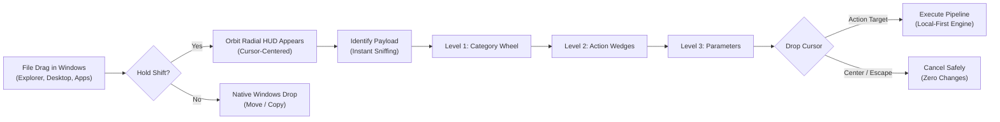
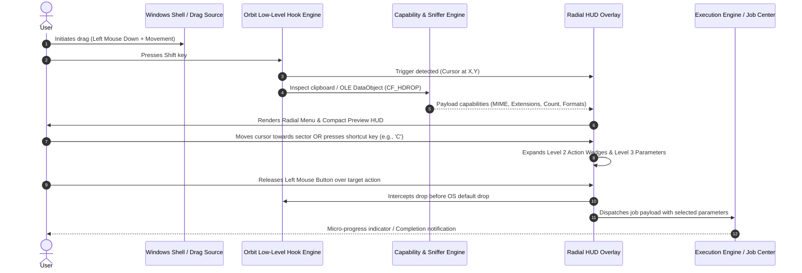
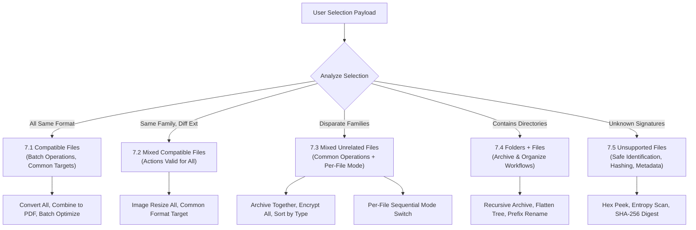
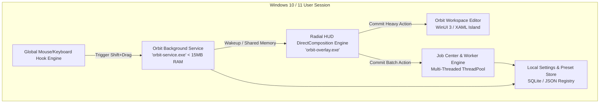

# Orbit — Product Specification

> **Version:** 1.0.0-PROD  
> **Status:** Approved Architecture Specification  
> **Target Platform:** Windows 10 (Build 19041+) / Windows 11 (All Builds, x64 and ARM64)  
> **Classification:** Core Technical Product Specification  

---

## 1. Vision & Core Concept

### 1.1 Executive Summary & Problem Space
Modern computer operating systems excel at file storage and retrieval, yet day-to-day file operations remain burdened by friction, context switches, and application silos. When a user on Windows needs to convert a WebP file to PNG, optimize a bloated PDF, extract audio from an MP4, or redact sensitive data from a screenshot, they encounter an inefficient array of broken workflows:
- **Context Menu Bloat:** Right-click context menus in Windows are cluttered, fragmented between legacy Win32 shell handlers and modern Windows 11 AppX handlers, and lack context-aware parameter tuning.
- **In-App Drop Zones:** Standalone utility apps demand that users switch focus, launch an application, wait for its UI to load, locate its specific drop target, and manually configure destinations.
- **Ad-Driven Web Converters:** Users routinely upload confidential documents, personal photographs, and proprietary code to dubious online converter websites, exposing themselves to data leakage, privacy violations, bandwidth bottlenecks, and silent telemetry.
- **CLI Overhead:** Powerful open-source engines like FFmpeg, ImageMagick, and Ghostscript offer comprehensive capabilities but require command-line fluency and syntactic memorization inaccessible to general users.

**Orbit** eliminates this friction by unifying file transformation, inspection, annotation, optimization, and organization into a single, global, cursor-centered interaction surface.

### 1.2 The Core Vision
Orbit is a global, gesture-driven file operations utility built natively for Windows. It introduces a single universal interface: a compact, cursor-centered radial command wheel that materializes on demand whenever and wherever a user begins dragging a file and presses the trigger modifier.

Instead of navigating away from the active task, the user stays entirely in their flow:
1. Drag a file anywhere in Windows (File Explorer, Desktop, browser download shelf, application window).
2. Press and hold the **Shift** key.
3. Orbit’s command wheel materializes instantly centered around the cursor, dynamically populated with valid actions for the exact file payload.
4. Hover through concentric sectors or press ergonomic key shortcuts to choose an operation and adjust parameters.
5. Release the mouse button to execute.



### 1.3 Architectural & Design Principles

#### 1. Universal Interface Native to Windows
Orbit feels like an organic extension of Windows 11 and Windows 10. Built with native C++/WinRT, DirectComposition, and DirectX, the radial wheel delivers hardware-accelerated 120Hz+ rendering with zero perceptible latency (< 16ms presentation time). It adheres strictly to the Microsoft Fluent Design System, integrating Acrylic material, Mica background effects, subtle elevation shadows, and smooth micro-animations.

#### 2. The Shift+Drag Paradigm (No Drop Zones)
Traditional desktop utilities treat the drop zone as an in-app destination. Orbit rejects the destination-window paradigm entirely. The entire operating system is Orbit's workspace. The radial menu follows the user's cursor dynamically; the file payload is already gripped in the user's hand when Orbit appears.

#### 3. First-Class System Drag Sources
Orbit is completely agnostic to where the drag originated. Supported drag sources include:
- Windows File Explorer (single and multi-tab windows, tree views, icon views).
- The Windows Desktop.
- Open/Save File Dialogs across any Win32, WPF, or WinUI application.
- Desktop search utilities (Flow Launcher, Everything, PowerToys Run).
- Alternative file managers (Directory Opus, Total Commander, OneCommander).
- Browser download shelves and attachment drop sources providing valid virtual streams or file paths (`CF_HDROP`, `CF_SHELLIDLIST`, `FileGroupDescriptorW`).

#### 4. 100% Local-First & Zero Silent Telemetry
Every operation supported by Orbit runs strictly on the local machine using embedded, highly optimized open-source and native OS libraries (e.g., Libvips, FFmpeg, PDFium, Libarchive, DirectWrite). No files are ever uploaded to cloud servers. No background network calls or analytics beacons accompany file operations. Orbit works in completely air-gapped enterprise environments.

> [!IMPORTANT]
> Orbit operates under a strict Zero-Network Data Policy: file contents never cross machine network boundaries unless the user explicitly triggers an outgoing "Share" plugin action that targets a user-configured network endpoint.

---

## 2. The Complete Interaction Model

Orbit structures every file interaction into an unbroken five-stage pipeline. The entire interaction can take less than one second for muscle-memory operations, or expand smoothly into parametric fine-tuning when precision is required.



### 2.1 Stage 1 — Enter Orbit (Trigger & Hook Architecture)
- **Initiation Gesture:** The user clicks and drags any file or selection of files using the Primary (Left) Mouse Button. While holding the button and moving the cursor past the system drag threshold (default: 4 pixels), the user presses and holds the **Shift** key.
- **Non-Disruptive OLE Hooking:** Windows OLE drag-and-drop loops (`DoDragDrop`) take exclusive capture of standard mouse messages. Orbit utilizes low-level global hooks (`WH_MOUSE_LL` and `WH_KEYBOARD_LL`) coupled with Windows UI Automation / Accessible Object drag trackers to intercept the gesture without terminating or invalidating the underlying OLE drag session.
- **Instant Overlay Presentation:** A transparent, top-most, per-pixel alpha DirectComposition window surfaces centered directly over the current cursor coordinate $(X_c, Y_c)$. 
- **Graceful Fallback:** If the user releases Shift while continuing to drag without entering an Orbit sector, the radial menu fades out smoothly (120ms ease-out) and standard Windows Explorer drag-and-drop semantics resume instantly without dropping or losing the file.

### 2.2 Stage 2 — Identify (Deep Inspection & Hub Rendering)
Within less than 8 milliseconds of trigger detection, Orbit's Sniffer Engine interrogates the active drag payload:
- **Data Extraction:** Reads `CF_HDROP`, `CF_UNICODETEXT`, or virtual file descriptor streams from the OLE `IDataObject`.
- **Magic Byte & MIME Sniffing:** Orbit reads the first 4,096 bytes (the file header) directly from disk or stream buffer to identify true file signatures, completely immune to spoofed or missing file extensions (e.g., detecting that an `.mp4` file is actually a WebM container, or identifying an extensionless file as a PNG).
- **Metadata Extraction:** Extracts key attributes asynchronously (dimensions, page count, duration, audio channels, archive file count, compression type, byte size).
- **Central Hub Rendering:** The center circle of the radial wheel (the "Hub") displays:
  - An ultra-fast high-DPI thumbnail preview or format vector glyph.
  - Primary format badge (e.g., `PNG • 2.4 MB` or `PDF • 18 Pages`).
  - Selection tally badge if multiple items are held (e.g., `14 Files • 86.2 MB`).

### 2.3 Stage 3 — Navigate (Sector Traversal & Ergonomics)
Orbit provides dual, fully synchronized navigation paradigms:

#### A. Spatial / Radial Cursor Navigation
The user moves the mouse outward from the central hub into one of the radial wedges:
- **Deadzone Safeguard:** A 36-pixel radius deadzone surrounding the cursor prevents accidental sector selection when the menu first pops up.
- **Polar Calculation:** The cursor angle $\theta = \operatorname{atan2}(\Delta Y, \Delta X)$ dynamically highlights the active category sector.
- **Angular Hysteresis:** An active sector provides an angular buffer zone ($\pm 4^\circ$) to prevent flickering across boundary seams.

#### B. Single-Key Mnemonic Shortcuts
For power users operating at speed, Orbit listens for single-key presses during the drag state to jump directly into categories without angular hunting:
- `C` $\rightarrow$ **Convert**
- `E` $\rightarrow$ **Edit**
- `A` $\rightarrow$ **Annotate**
- `O` $\rightarrow$ **Organize**
- `P` $\rightarrow$ **Optimize**
- `X` $\rightarrow$ **Extract**
- `S` $\rightarrow$ **Secure**
- `I` $\rightarrow$ **Inspect / Analyze**

Pressing any mnemonic instantly pivots the radial menu directly into that category's Level 2 actions.

### 2.4 Stage 4 — Choose Action (Level 2 Submenus & Level 3 Parameters)
- **Level 2 Action Expansion:** Hovering over or selecting a Category sector smoothly animates an outer concentric arc or cascading sub-palette containing valid actions for that category.
- **Level 3 Parameter Tuning:** Certain high-frequency actions expose immediate parametric quick-scrub controls on the HUD:
  - Quality sliders (0–100% lossy compression).
  - Format resolution presets (Original, 4K, 1080p, 720p, 50%, 25%).
  - Audio bitrate pills (320k, 256k, 192k, 128k).
  - Page range selectors (All, Current, Split Odd/Even).
- **Transition to Orbit Workspace:** If the user selects an operation that requires fine-grained manual composition (such as multi-layer screenshot annotation, complex PDF page reordering, or frame-by-frame video trimming), the user can drop onto the "Open in Workspace" wedge. The radial menu collapses and smoothly expands into a dedicated, floating, lightweight WinUI 3 editor window, pre-loaded with the file.

### 2.5 Stage 5 — Execute (Drop to Commit & Output Routing)
- **Commit Gesture:** Releasing the primary mouse button while hovered over any valid Action or Parameter wedge triggers execution immediately.
- **Safe Cancellation:** Releasing the mouse button inside the Central Deadzone Hub, releasing the mouse outside the outer perimeter boundary of Orbit, or pressing the `Esc` key cancels the entire operation cleanly. The underlying file remains completely untouched.
- **Execution Feedback:** Upon commit, the radial menu collapses into a sleek micro-progress ring centered where the drop occurred, showing radial progress and a completion tick.
- **Output Destination Policy:**
  - **In-Place Non-Destructive (Default):** Generates new output files in the origin folder with semantic suffixes (e.g., `document_compressed.pdf`, `photo_optimized.webp`).
  - **In-Place Overwrite (Modifier-Triggered):** Holding `Alt` on drop explicitly confirms in-place overwrite.
  - **Target Folder Drop:** If dragged over a specific destination folder while Shift is released at the parameter stage, Orbit routes the processed output directly into that folder.
- **Return to Workflow:** Once dispatched, focus returns instantly to the source application. Operations taking over 200ms run entirely in background worker threads without freezing the Windows desktop.

---

## 3. The Radial Menu Architecture

The Orbit radial interface is engineered as a three-tier concentric hierarchical command wheel. The geometry is mathematically optimized to balance sector surface area, thumb/wrist biomechanics, and visual clarity on high-DPI displays (from 100% to 300% DPI scaling).

```
                      [ Level 3: Parameters Ring (r = 185px - 225px) ]
                  [ Level 2: Actions Submenu Ring (r = 120px - 180px) ]
              [ Level 1: Categories Ring (r = 55px - 115px) ]
           /-------------------------------------------------------\
          /                      CONVERT                            \
         /            /-----------------------------\                \
        /            /        WebP      JPG          \                \
       /   SECURE   /     /-------------------\       \     EDIT       \
      |            |     |    (Deadzone)       |       |                |
      |  ANALYZE   |     |    Central Hub      |       |   ANNOTATE     |
      |            |     |   Preview & Stats   |       |                |
       \  EXTRACT   \     \-------------------/       /    OPTIMIZE    /
        \            \        ZIP       7Z           /                /
         \            \-----------------------------/                /
          \                      ORGANIZE                           /
           \-------------------------------------------------------/
```

### 3.1 Three Levels of Menu Hierarchy

| Hierarchy Level | Radius Band | Visual Role & Interaction |
| :--- | :--- | :--- |
| **Level 0: Central Hub** | $r \in [0, 52]\,\text{px}$ | Inactive safety deadzone. Displays primary file thumbnail, MIME badge, total selection count, and aggregate size. Dropping here safely aborts. |
| **Level 1: Category Ring** | $r \in [55, 115]\,\text{px}$ | The primary wheel. Displays the 11 major operational categories as iconographic sectors with labels. Only categories valid for the current selection are active; invalid categories are dynamically pruned. |
| **Level 2: Action Ring** | $r \in [120, 180]\,\text{px}$ | Materializes when hovering over or entering a category. Deploys targeted operations (e.g., for Convert $\rightarrow$ PNG, WebP, JPG, AVIF, SVG). |
| **Level 3: Parameter HUD** | $r \in [185, 230]\,\text{px}$ | Fine-tuning controls appearing tangential to the selected action (quality presets, resolution scales, bitrates, encryption toggles, compression levels). |

### 3.2 Master Category Taxonomy (All 11 Categories)

Orbit organizes all operating system file tasks into 11 distinct, mutually exclusive functional categories:

| Index | Category | Shortcut | Icon Glyphs | Core Functional Scope |
| :---: | :--- | :---: | :---: | :--- |
| **1** | **Convert** | `C` | `arrow.triangle.2.circlepath` | Cross-format transformations, container remuxing, rasterization, vectorization, encoding transcoding, and data serialization. |
| **2** | **Edit** | `E` | `slider.horizontal.3` | Content and structural modifications: trim, cut, crop, rotate, resize, merge, split, reorder, color adjustments, audio leveling. |
| **3** | **Annotate** | `A` | `pencil.tip.crop.circle` | Non-destructive markups, highlights, callouts, arrows, shapes, text layers, redaction blocks, stamps, and watermarks. |
| **4** | **Optimize** | `P` | `bolt.badge.automatic` | Size reduction, lossless/lossy compression, downsampling, stream deduplication, unused font subsetting, and metadata stripping. |
| **5** | **Organize** | `O` | `folder.badge.gear` | Batch renaming with pattern variables, rule-based folder routing, date sorting, deduplication, and automated filing. |
| **6** | **Extract** | `X` | `tray.and.arrow.down` | Archive unpacking, embedded asset scraping (images from DOCX/PDF, audio tracks from video, attachments from email/EML). |
| **7** | **Secure** | `S` | `lock.shield` | Password encryption (AES-256), digital signing, integrity hashing (SHA-256/512), metadata sanitization, and PII masking. |
| **8** | **Analyze** | `I` | `magnifyingglass.circle` | Deep metadata inspection, stream diagnostics, EXIF/IPTC peeking, PDF font audits, hex dumps, entropy analysis, and virus scan check. |
| **9** | **Create** | `N` | `plus.square.dashed` | Synthesis workflows: archive from selection, multi-page PDF from images, contact sheet / collage, sprite sheet, animated GIF from clips. |
| **10**| **Share** | `H` | `paperplane` | Fast OS handoffs: copy file to clipboard as data URL/base64, generate local LAN QR code for mobile drop, Windows Share contract. |
| **11**| **More** | `M` | `ellipsis.circle` | Opens selection in Orbit Workspace editor, custom user-defined scripts/batch commands, third-party plugin invocations. |

### 3.3 Dynamic Contextual Adaptation
Orbit never presents a cluttered, non-functional menu. If a user drags an MP3 audio file:
- Categories like **Extract**, **Annotate** (image-markup), or **3D** are pruned or grayed out.
- Categories like **Convert** (to WAV, FLAC, AAC, OGG), **Edit** (Trim, Normalize, Fade), **Optimize** (Bitrate, Mono downmix), and **Analyze** (Waveform, Bitrate, LUFS loudness) expand to fill the primary radial arc.

> [!NOTE]
> The angular span of individual sectors automatically resizes between $30^\circ$ and $60^\circ$ depending on the count of valid categories for the payload, ensuring adequate touch and pointer targets at all times.

---

## 4. Modifier Key & Gesture System

### 4.1 Master Input Binding Matrix

| Input Trigger | Context / State | System Action | Safety & State Guarantee |
| :--- | :--- | :--- | :--- |
| **Drag + Shift (Hold)** | Anywhere in OS | Spawns Orbit Radial HUD centered at cursor | Drag loop preserved; no drop event dispatched to underlying window. |
| **Release Shift** | Radial HUD active | Dismisses Orbit HUD with smooth fade-out | Restores standard Windows Explorer drag drop target logic. |
| **Mouse Move** | Inside Radial HUD | Calculates polar angle $\theta$, highlights sector | Purely visual hover state; no file modification occurs. |
| **Key `C`** | Level 1 active | Jumps directly to **Convert** category | Instant sub-menu transition; non-destructive. |
| **Key `E`** | Level 1 active | Jumps directly to **Edit** category | Instant sub-menu transition; non-destructive. |
| **Key `A`** | Level 1 active | Jumps directly to **Annotate** category | Instant sub-menu transition; non-destructive. |
| **Key `O`** | Level 1 active | Jumps directly to **Organize** category | Instant sub-menu transition; non-destructive. |
| **Key `P`** | Level 1 active | Jumps directly to **Optimize** category | Instant sub-menu transition; non-destructive. |
| **Key `X`** | Level 1 active | Jumps directly to **Extract** category | Instant sub-menu transition; non-destructive. |
| **Key `S`** | Level 1 active | Jumps directly to **Secure** category | Instant sub-menu transition; non-destructive. |
| **Key `I`** | Level 1 active | Jumps directly to **Analyze / Inspect** | Opens deep inspection HUD overlay; non-destructive. |
| **Key `Esc`** | Any Level active | Aborts Orbit and terminates overlay | Drag continues as standard Windows drag; no actions fired. |
| **Mouse Wheel** | Over Parameter HUD | Steps parameter values up or down (e.g. quality $\pm 5\%$) | Adjusts transient parameter state on the HUD. |
| **Release Mouse** | Over Action/Param Wedge | **Commits and Executes** target operation | Atomic job dispatch; file processing initiates immediately. |
| **Release Mouse** | Inside Central Hub ($r < 52\text{px}$) | **Aborts safely** | Dismisses Orbit without executing any file operations. |
| **Release Mouse** | Beyond Outer Ring ($r > 240\text{px}$) | **Aborts safely** | Dismisses Orbit without executing any file operations. |
| **Ctrl + Drop** | On Action Wedge | Fork Execution (Save to separate "Orbit Output" folder) | Preserves source directory cleanliness. |
| **Alt + Drop** | On Action Wedge | Overwrite Source File (In-Place destructive commit) | Prompt bypassed only if user has explicitly enabled setting. |

### 4.2 Critical Safety & Ergonomic Rules

#### Rule 1: Navigation Is Never Destructive
Merely highlighting, navigating into, expanding, or previewing a category or action must NEVER execute or alter file system state. Files are only read in memory for metadata analysis. No temporary files or locks are created in the origin folder during navigation.

> [!WARNING]
> Under no circumstances may sector hover, keyboard shortcut preview, or mouse-over trigger a file modification, file move, or background conversion task. All execution pipelines remain strictly dormant until explicit mouse release over an action wedge.

#### Rule 2: Deterministic Commit and Absolute Cancellation
Every action has a razor-sharp commit boundary: the release of the physical mouse button over a designated wedge. If the cursor is released anywhere outside a valid action wedge (such as the central hub or outer perimeter), the entire session cleanly tears down with zero side effects.

#### Rule 3: Configurable Global Keymap
Every key binding is fully reconfigurable through the Orbit Settings Dashboard. Users can switch the entry trigger from `Shift + Drag` to `Ctrl + Drag`, `Alt + Drag`, `Right Mouse Drag`, or a specific auxiliary mouse button (Mouse 4 / Mouse 5).

### 4.3 Coexistence with Windows Drag-and-Drop Semantics
Windows Explorer natively assigns semantic meanings to modifier keys during drag operations:
- Holding `Ctrl` forces a **Copy** action (`DROPEFFECT_COPY`).
- Holding `Shift` forces a **Move** action (`DROPEFFECT_MOVE`).
- Holding `Alt` forces a **Shortcut** creation (`DROPEFFECT_LINK`).

To eliminate collisions between Orbit and Windows Shell drag semantics:
1. **Paired Hold Recognition:** Orbit only triggers when the drag has traveled beyond the minimum threshold and the trigger key is held for a minimum dwell time (configurable, default: 150ms). A rapid drag-and-drop flick with Shift held executes standard Windows Explorer Move without triggering Orbit.
2. **Drop Interception:** When the user releases the mouse over an Orbit action wedge, Orbit claims the drop target by sending an `OLE_CANCEL` / `DRAGDROP_S_CANCEL` response to the source window and immediately handles the file paths through Orbit's local worker engine. Explorer is never notified of a native file drop, preventing unintended file moves or deletions.
3. **UIPI & UAC Isolation:** The Orbit background monitor registers with proper UI Access privileges (`uiAccess="true"` in the application security manifest) and hooks across unelevated and elevated (Administrator) Explorer windows to guarantee consistent drag capture without privilege isolation deadlocks.

---

## 5. File Family Operation Catalogues

Orbit provides comprehensive, dedicated capability pipelines for all major file families. The following catalogues detail supported formats, categories, operations, parameter bounds, engine backends, and specialized handling rules.

### A. Images
**Supported Formats:** PNG, JPG, JPEG, WebP, GIF, BMP, TIFF, SVG, AVIF, HEIC, ICO  
**Engine Backends:** Libvips, Libspng, MozJPEG, Libwebp, Giflib, Resvg, Libheif, Potrace

| Category | Operation | Parameters / Options | Engine & Technical Behavior |
| :--- | :--- | :--- | :--- |
| **Convert** | Cross-Format Conversion | Target: WebP, PNG, JPG, AVIF, TIFF, BMP; Quality (1–100), Lossless toggle, Chroma (4:2:0, 4:4:4) | **Transparency Handling:** Converting transparent PNG/WebP to JPG prompts for matte background fill (default: Pure White `#FFFFFF`). |
| **Convert** | Convert to ICO | Multi-layer sizes: 16x16, 32x32, 48x48, 64x64, 128x128, 256x256 | Assembles standard Windows multi-resolution icon container with PNG compression for 256px layer. |
| **Convert** | Vectorize (Raster $\rightarrow$ SVG) | Threshold, Color Quantization (2–64 colors), Curve Smoothness | **Vectorization vs Wrapping:** Executes true Potrace / Autotrace bezier curve fitting, not superficial SVG bitmap encapsulation. |
| **Convert** | Rasterize (SVG $\rightarrow$ PNG/WebP) | Target DPI (72, 150, 300, 600), Scaling Factor (1x, 2x, 4x, 8x) | High-precision vector rasterization using Resvg with antialiasing and full CSS/SVG spec support. |
| **Convert** | Animation Conversion | GIF to Animated WebP, GIF to MP4 (H.264), APNG to WebP | Generates high-efficiency modern animated containers; WebP yields 60-80% byte reduction over GIF. |
| **Edit** | Crop & Aspect Ratio | Freeform, 1:1 Square, 16:9, 4:3, 9:16, Smart Saliency Auto-Crop | Saliency engine detects face and subject focal points to crop without severing key subject matter. |
| **Edit** | Rotate & Flip | 90° CW, 90° CCW, 180°, Flip Horizontal, Flip Vertical | For JPEGs, performs lossless MCU block transformation without decompressing or re-quantizing DCT coefficients. |
| **Edit** | Resize & Downscale | Percentage (25%, 50%, 75%), Dimension clamp (Max 1920px, 4K), Lanczos3 / Nearest Neighbor | High-performance SIMD-accelerated filtering via Libvips preserving edge sharpness. |
| **Edit** | Brightness & Contrast | Brightness (-100 to +100), Contrast (-100 to +100), Auto-Levels | Fast GPU/SIMD LUT application with 16-bit color precision pipeline. |
| **Edit** | Color Profile Management | Convert to sRGB, Embed ICC Profile, Strip ICC Profile, Assign Display P3 | Precision LittleCMS2 color management engine preserving color appearance across devices. |
| **Edit** | Watermark | Text string, Watermark image, Opacity (10–100%), Corner Anchor, Tile Pattern | Composite blending over canvas with alpha channel preservation. |
| **Annotate** | Freehand, Arrows & Shapes | Freehand Pen, Ink Highlighter, Directional Arrow, Rectangle, Ellipse | Non-destructive vector overlay layer; flattens seamlessly upon final export. |
| **Annotate** | Text & Stickers | Text Callout Box, Rich Typography, Vector Stickers, Rubber Stamps | Injects scalable vector stickers (Approved, Confidential, Review) with custom fill opacity. |
| **Annotate** | Blur, Pixelate & Redact | Blur radius, Pixel block size (4px–32px), Solid Black Redaction bar | **True Redaction:** Irreversibly replaces raster pixel values beneath the redact rectangle; no hidden layers. |
| **Optimize** | Lossy & Lossless Compression | Presets: Maximum, Balanced, Fast; Quality Slider (1–100) | Runs Oxipng, MozJPEG trellis quantization, and Libwebp lossless mode for maximum efficiency. |
| **Optimize** | Metadata Stripping | Strip EXIF, IPTC, XMP, GPS location, Camera Serial | Scrubs personal identifiable metadata while preserving image raster integrity. |
| **Optimize** | Target File Size Constraint | Target Byte Size (e.g., `< 500 KB`, `< 2 MB`) | Iterative bisection search on quality factor to guarantee output falls strictly below requested threshold. |
| **Analyze** | Dimensions, EXIF, Color & Orientation | Width/Height, DPI, Color Space (sRGB/P3), EXIF Dump, Camera Orientation Tag | Inspects dimensions, color depth, ICC profile, and validates EXIF orientation flag against visual raster. |

---

### B. PDF & Documents
**Supported Formats:** PDF, DOCX, DOC, ODT, RTF, TXT, MD, HTML, EPUB  
**Engine Backends:** PDFium, Poppler, LibreOffice Headless (Optional), Pandoc, Tesseract OCR

| Category | Operation | Parameters / Options | Engine & Technical Behavior |
| :--- | :--- | :--- | :--- |
| **Convert** | Documents to PDF | Page layout, orientation, margin clamp, PDF/A-2b compliance | **Renderer Requirements:** Uses local headless LibreOffice or native OpenXML vector engine to convert DOCX/DOC/ODT/RTF to PDF. |
| **Convert** | Markdown / HTML to PDF | Theme (GitHub, Academic, Minimalist), Code highlighting, Page numbers | Chromium/WebKit headless print pipeline converting styled CSS/HTML/MD to vector print PDF. |
| **Convert** | EPUB to PDF / TXT | Font size, Margins, Page dimensions, Cover image extraction | Structural reflow renderer generating fixed-layout PDF or clean raw text from EPUB containers. |
| **Convert** | PDF to Images / Text | Format (PNG, JPG, WebP), DPI (150, 300, 600), Single pages vs ZIP archive | High-fidelity page rasterization via PDFium or structural text extraction preserving tables. |
| **Edit** | Merge PDFs | Page ordering list, insert blank separator | Combines multiple PDF payloads into a single contiguous document without rasterizing content. |
| **Edit** | Split & Extract Pages | Split every N pages, Extract Range (e.g., `1-4, 7, 12-end`), Split by Bookmarks | Losslessly extracts page trees and associated font dictionaries into independent PDF documents. |
| **Edit** | Reorder, Rotate & Delete | Reorder page list, Rotate (90° CW, 180°), Delete specific page indices | Modifies PDF page tree dictionary attributes (`/Rotate`, `/Kids`) in milliseconds without re-encoding. |
| **Edit** | Watermarks & Numbering | Watermark text/stamp, Position (Top/Bottom, Left/Center/Right), Page Numbering (`Page X of Y`) | Injects dynamic vector content streams across designated page ranges. |
| **Annotate** | Highlights, Ink & Shapes | Text highlight (Yellow, Green, Cyan), Underline, Strikethrough, Freehand Ink, Shapes | Injects standard compliant PDF annotation dictionaries (`/Highlight`, `/Ink`, `/Square`) compatible with Adobe Acrobat. |
| **Annotate** | Sticky Notes & Stamps | Sticky note comment popups, Rubber Stamps (Approved, Confidential, Draft) | Adds standard PDF text annotations (`/Text`) and appearance stream vector stamps. |
| **Annotate** | Signatures & Redaction | Visual signature stamp, Cryptographic placeholder, Permanent Redaction | **Destructive Redaction:** Removes underlying vector paths, text glyphs, and raster image data beneath the zone. |
| **Optimize** | Compress PDF | Preset: Web (150 DPI), Print (300 DPI), Extreme (Screen 72 DPI, Mono JBIG2) | Downsamples embedded images, runs FlateDecode stream compression, and strips unreferenced indirect objects. |
| **Optimize** | Searchable OCR | Language selection (Eng, Deu, Fra, Spa, + 40 packs), Deskew, Binarize | Tesseract OCR generates an invisible text layer perfectly mapped over scanned raster image pages. |
| **Secure** | Password Protect & Encrypt | User Password (open), Owner Password (permissions: printing, copying), AES-256 | Applies standard Adobe PDF AES-256 bit encryption engine with granular security permission flags. |
| **Analyze** | Page Count, Fonts, Links & Bookmarks | Page count, PDF version, Font status (Embedded/Missing), Link validator, Bookmark tree, Forms | Inspects PDF catalog tree for broken internal links, non-embedded fonts, form fields, and bookmark hierarchy. |

---

### C. Video
**Supported Formats:** MP4, MOV, MKV, WebM, AVI, WMV, FLV, M4V  
**Engine Backends:** FFmpeg, Libavcodec, Hardware Decoders (NVIDIA NVENC, Intel QSV, AMD AMF)

| Category | Operation | Parameters / Options | Engine & Technical Behavior |
| :--- | :--- | :--- | :--- |
| **Convert** | Remux vs Transcode | Container Swap: MKV $\leftrightarrow$ MP4, MOV $\rightarrow$ MP4, WebM $\rightarrow$ MKV | **Remux vs Transcode:** Container swap uses stream copy (`-codec copy`) in < 1s with zero generation loss; transcode re-encodes streams. |
| **Convert** | Cross-Codec Transcoding | Target Codecs: H.264, H.265/HEVC, AV1, VP9, ProRes; Container targets | Hardware-accelerated encoding pipeline utilizing GPU silicon, with CPU fallback (SVT-AV1, x264, x265). |
| **Convert** | Extract Audio Track | Output format (MP3, AAC, FLAC, WAV, Opus), Quality (VBR/CBR), Channels | Demuxes audio streams from video container and exports standalone audio file. |
| **Convert** | Video to Animated GIF / WebP | FPS (10, 15, 24), Width (480p, 720p), Two-Pass Palette Generation | Generates dynamic 256-color palette via `palettegen` filter to avoid dithering artifacts in output GIF. |
| **Edit** | Trim & Frame-Accurate Cut | Lossless Keyframe Trim vs Frame-Accurate Smart Cut at exact timestamp | Fast keyframe cut copies streams; smart cut re-encodes only boundary GOP slices to guarantee precision. |
| **Edit** | Concatenate Videos (Concat) | File list ordering, Stream copy mode vs Normalize re-encode | Losslessly concatenates video segments sharing identical codecs, or normalizes mixed inputs into one file. |
| **Edit** | Crop & Aspect Ratio | 16:9, 9:16 (Vertical TikTok/Reels), 1:1 Square, 4:3, Custom Box | Applies hardware-accelerated scaling and crop filters; auto-pads letterbox if requested. |
| **Edit** | Rotate Video | 90° CW, 90° CCW, 180° | **Metadata Rotation:** Modifies MP4 display matrix metadata tag (instantaneous, no quality loss). |
| **Edit** | Subtitles Management | Embed external SRT/ASS to soft subtitles, Burn-in hard subtitles, Extract subtitles | Merges subtitle text streams into container or burns glyphs directly into video raster frames. |
| **Annotate** | Frame-Level Markup & Overlay | Image logo watermark, Burned-in timecode, Text callout overlay, Censor blur box | Composites visual annotations and timecode indicators over video frames using FFmpeg filtergraphs. |
| **Optimize** | H.264 / H.265 / AV1 Presets | Encoding Presets: Ultra-Fast, Balanced, High Quality; CRF (18–28); Hardware acceleration | Applies codec-optimized Constant Rate Factor (CRF) profiles for streaming, archiving, and web playback. |
| **Optimize** | Target File Size (Auto-Bitrate) | Target size (Discord 10MB/25MB, Email 20MB, Custom MB limit) | Calculates precise two-pass bitrate: $\text{Bitrate} = (\text{Target Size} \times 8) / \text{Duration} - \text{Audio Bitrate}$. |
| **Analyze** | Duration, Resolution, Codecs & Bitrates | Video/Audio codecs, Bitrate, Resolution, Duration, FPS, Color Space (BT.709 vs HDR10) | Deep stream diagnostics via FFprobe inspecting stream headers, sample aspect ratio, and audio channel layout. |

---

### D. Audio
**Supported Formats:** MP3, WAV, FLAC, AAC, M4A, OGG, Opus, AIFF, WMA  
**Engine Backends:** FFmpeg, Libsndfile, TagLib, LAME, Opus-Tools

| Category | Operation | Parameters / Options | Engine & Technical Behavior |
| :--- | :--- | :--- | :--- |
| **Convert** | Audio Format Transcoding | Target: FLAC, MP3, AAC, WAV, OGG, Opus; Bitrate (128k–320k, VBR/CBR) | High-fidelity transcoding between lossy and lossless codecs with dithering algorithms applied. |
| **Convert** | Resample & Bit Depth | Sample Rate (44.1 kHz, 48 kHz, 96 kHz), Bit Depth (16-bit, 24-bit, 32-bit float) | Resamples audio using SoX resampler algorithms with high phase response preservation. |
| **Edit** | Trim, Cut & Silence Trimming | Start/End timestamps, Crossfade boundaries, Silence strip threshold (-50dB) | Cuts audio buffers with seamless anti-pop endpoint crossfades and strips dead air. |
| **Edit** | Fade & Channel Mixdown | Fade In/Out duration (0.5s–5s), Stereo to Mono, Mono to Dual-Mono, Swap L/R | Applies dynamic gain envelope curves and downmixes channels with -3dB clipping protection. |
| **Annotate** | Metadata & Tag Editor | Title, Artist, Album, Year, Genre, Track Number, Embedded Album Art | Modifies ID3v2.4, Vorbis Comments, and MP4 metadata atoms in-place via TagLib. |
| **Optimize** | Volume Normalization | Standards: EBU R128 (Broadcast -23 LUFS), Spotify/YouTube (-14 LUFS), Peak | Analyzes integrated loudness (LUFS) and applies non-destructive gain correction factor. |
| **Optimize** | Speech & Voice Preset | High-pass filter (80Hz rumble cut), Speech dynamic compressor, Opus 64kbps | Strips low-frequency noise and applies voice-band compression for podcast and lecture recordings. |
| **Analyze** | Audio Waveform & Loudness | Integrated LUFS, True Peak (dBTP), Dynamic Range (DR), Sample Rate, Bitrate | Renders mini waveform profile directly on the radial HUD with clipping detection flags. |
| **Create** | Audio Synthesis & Ringtone | Concatenate tracks, Generate silence / test tone (440Hz), Export iPhone Ringtone (`.m4r`) | Combines audio tracks into unified stream or formats custom 30s looped ringtones for mobile devices. |

---

### E. Archives & Compressed Containers
**Supported Formats:** ZIP, 7Z, TAR, GZ, BZ2, XZ, RAR (Decompress only), CAB, ISO  
**Engine Backends:** Libarchive, 7-Zip LZMA Engine, Zstandard

| Category | Operation | Parameters / Options | Engine & Technical Behavior |
| :--- | :--- | :--- | :--- |
| **Extract** | Safe Extraction (Smart Folder) | Destination: Current Directory, Dedicated Enclosing Folder, Desktop | **Smart Folder Rule:** If archive contains multiple root items, automatically encloses them in a named folder to prevent desktop clutter. |
| **Extract** | Extract Single Item | Browse internal archive hierarchy, extract individual target file | Streams target file directly out of archive without unpacking entire container to disk. |
| **Convert** | Re-pack Archive | Convert between formats: TAR.GZ $\rightarrow$ ZIP, 7Z $\rightarrow$ ZIP, RAR $\rightarrow$ 7Z | Unpacks in memory stream and re-compresses into standard open format. |
| **Edit** | Append / Delete Items | Add dragged file into existing archive, Remove item from archive | Rewrites archive central directory table without full decompress/re-compress cycle where supported (ZIP). |
| **Optimize** | Recompress for Maximum Ratio | Compression Level (Store, Fast, Normal, Maximum, Ultra), Dict Size | Re-evaluates archive using 7-Zip LZMA2 / Zstandard with optimal dictionary allocations. |
| **Secure** | Encrypt Archive (AES-256) | AES-256 Encryption, Encrypt Header (Hide file names in 7Z) | Enforces military-grade AES-256 password protection; header encryption prevents viewing catalog contents. |
| **Secure** | Path Traversal & Bomb Guard | Path sanitization, Ratio checks: Max ratio 100:1, Max uncompressed size 20 GB | **Security Shield:** Inspects relative paths for directory traversal (`../` Zip-Slip) and aborts malicious decompression bombs. |
| **Analyze** | Integrity & Catalog Audit | CRC32/SHA-256 validation, File count, Compression ratio, Encrypted status | Performs non-destructive CRC verification pass across all compressed blocks to detect corruption. |

> [!CAUTION]
> Archive extraction automatically blocks decompression of entities whose expansion ratio exceeds 100:1 or total uncompressed volume exceeds 20 GB without explicit secondary confirmation. Any internal path containing `../` or absolute drive anchors is rejected to neutralize path traversal (Zip-Slip) attacks.

---

### F. Spreadsheets & Presentations
**Supported Formats:** XLSX, CSV, ODS, PPTX, PPT, TSV  
**Engine Backends:** FastExcel, DuckDB, OpenXML SDK, LibreOffice Headless

| Category | Operation | Parameters / Options | Engine & Technical Behavior |
| :--- | :--- | :--- | :--- |
| **Convert** | XLSX $\leftrightarrow$ CSV / TSV / JSON | Delimiter (Comma, Semicolon, Tab), Encoding (UTF-8, UTF-8 with BOM), JSON Array | High-speed data parsing; handles embedded linebreaks and quotation escaping correctly. |
| **Convert** | Spreadsheet to PDF | Page orientation (Landscape/Portrait), Fit to 1 Page Wide, Gridlines visible | Formats tabular data with clean border outlines into vector printable PDF documents. |
| **Convert** | Presentation to PDF / Images | Slide deck to single multi-page PDF, Export all slides as PNG/WebP | Converts each presentation slide into crisp, high-resolution vector or raster presentation graphics. |
| **Edit** | Clean & Trim Tabular Data | Trim whitespace, Remove blank rows, Deduplicate rows by key column | Performs in-memory tabular cleanup and emits sanitized, consistent output file. |
| **Edit** | Extract Slide Deck Range | Extract slides (e.g., `1-10, 15`), Strip presenter speaker notes | Modifies OpenXML presentation package to isolate selected slide trees. |
| **Annotate** | Reviewer Notes & Watermarks | Insert cell comments, Author metadata tag, Watermark presentation slides | Embeds non-destructive reviewer notes and background watermark marks across slide decks. |
| **Optimize** | Media Optimization in PPTX/XLSX | Compress embedded slide videos/images, Strip revision history | Traverses internal OpenXML ZIP structure to recompress embedded image media from PNG to WebP/JPEG. |
| **Analyze** | Tabular & Slide Statistics | Row count, Column count, Data type inferencing, Slide tally, Embedded media size | Analyzes schema types (Integer, Float, Date, String) per column; reports aggregate data footprint. |
| **Create** | Spreadsheet Template / Deck | Generate empty sheet from schema headers, Create slide deck from text outline | Synthesizes formatted XLSX or PPTX files based on structured text input. |

---

### G. Code & Text
**Supported Formats:** TXT, MD, JSON, XML, YAML, TOML, CSV, SQL, HTML, CSS, JS, TS, PY, RS, GO, C, CPP  
**Engine Backends:** Simdjson, Tree-sitter, Prettier Core, Pandoc, Ripgrep Engine

| Category | Operation | Parameters / Options | Engine & Technical Behavior |
| :--- | :--- | :--- | :--- |
| **Convert** | Data Interchange | JSON $\leftrightarrow$ YAML $\leftrightarrow$ XML $\leftrightarrow$ TOML $\leftrightarrow$ CSV | High-speed bidirectional schema-preserving transformation with data type preservation (booleans, numbers). |
| **Convert** | Markdown $\leftrightarrow$ HTML | Flavor (GitHub Flavored Markdown, CommonMark), Typography quotes | Converts markdown documentation into styled semantic HTML5 or vice versa. |
| **Convert** | Encoding & Line Endings | Line Endings (CRLF $\leftrightarrow$ LF), Encoding (UTF-8, UTF-16 LE/BE, ISO-8859-1) | Normalizes line termination markers and converts byte order marks across operating systems. |
| **Edit** | Code Formatting / Minifying | Format / Prettify (indent: 2/4 spaces, tabs), Minify (strip whitespace/comments) | Leverages syntax parsers to format code or compact production bundles without altering AST semantics. |
| **Edit** | Text Sorting & Deduplication | Alphabetical sort, Natural sort, Case-insensitive, Remove duplicate lines | Performs memory-mapped line streaming and sorting for massive multi-gigabyte log and data files. |
| **Annotate** | Add License Header / Banner | License template (MIT, Apache 2.0, GPLv3, Proprietary Copyright) | Comments and prepends standard open-source or enterprise copyright header block to source files. |
| **Optimize** | Minification & Whitespace Strip | JS/CSS/HTML whitespace and identifier minification, Compact JSON | Compresses text footprint for deployment while preserving functional execution. |
| **Secure** | Secret & API Key Sanitizer | Scan for exposed secrets (AWS keys, OpenAI tokens, Private keys, JWTs) | Scans file text using high-entropy heuristic regexes; highlights or redacts secrets before sharing. |
| **Secure** | Hash Generation | Algorithms: SHA-256, SHA-512, MD5, SHA-1, BLAKE3 | Calculates cryptographic digests and copies to clipboard or generates `.sha256` checksum file. |
| **Analyze** | Text & Code Metrics | Line count (SLOC), Word count, Character count, Token count, AST validity | Evaluates syntax validity, indent distribution, and provides token count estimation for LLM contexts. |

---

### H. Fonts & Design
**Supported Formats:** TTF, OTF, WOFF, WOFF2, SVG, EPS, PSD, AI  
**Engine Backends:** FreeType, HarfBuzz, FontTools, Libspiro, Ghostscript

| Category | Operation | Parameters / Options | Engine & Technical Behavior |
| :--- | :--- | :--- | :--- |
| **Convert** | Web Font Conversion | TTF/OTF $\rightarrow$ WOFF2, WOFF $\rightarrow$ TTF/OTF | Compresses font glyph streams using Brotli compression for maximum web loading efficiency. |
| **Convert** | Vector Graphics Interchange | EPS $\rightarrow$ SVG, AI $\rightarrow$ SVG / PDF, PSD $\rightarrow$ Flattened PNG | Rasterizes or translates proprietary vector and print formats into standardized web SVG and PDF. |
| **Edit** | Font Subsetting | Charset (Basic Latin, Latin Extended, Cyrillic, Custom characters string) | Strips unneeded unicode glyphs from font binaries, slashing font file sizes by up to 90%. |
| **Edit** | Extract PSD Layers | Export all layers as discrete PNG files, Preserve layer coordinates | Parses Photoshop PSB/PSD layer record blocks, extracting raster layers with alpha blending. |
| **Annotate** | Font Metadata & Layer Notes | Edit font copyright/designer metadata, View OpenType feature tags | Modifies font naming tables and inspects designer attribution records. |
| **Optimize** | SVG Vector Optimization | Precision decimals (1–5), Strip metadata, Merge paths, Remove editor XML | Runs SVGO engine to clean redundant Illustrator/Figma tags and minimize SVG file weight. |
| **Analyze** | Font Metrics & Licensing | Family name, PostScript name, Weight, Designer, License URL, Glyph count | Inspects OpenType `name`, `OS/2`, and `cmap` tables; previews character set rendering on radial HUD. |
| **Create** | Generate Web Font Kit | Output: WOFF2 + WOFF + Fallback TTF + `@font-face` CSS snippet + HTML tester | Generates a complete web font distribution package ready for web integration. |

---

### I. 3D & Scientific
**Supported Formats:** STL, OBJ, GLB, GLTF, FBX, PLY, FITS, DICOM  
**Engine Backends:** Assimp, Open3D, Draco, CFITSIO, DCMTK (Optional Capability Modules)

| Category | Operation | Parameters / Options | Engine & Technical Behavior |
| :--- | :--- | :--- | :--- |
| **Convert** | 3D Mesh Interchange | STL $\leftrightarrow$ OBJ $\leftrightarrow$ GLB/glTF, FBX $\rightarrow$ GLB | Translates 3D vertex, normal, and texture mapping buffers across CAD and real-time formats. |
| **Convert** | Scientific to Raster | FITS / DICOM $\rightarrow$ 16-bit PNG / TIFF / JPG, Color LUT (Heatmap, Greyscale) | Normalizes high dynamic range astronomical (FITS) and medical (DICOM) imagery for visual display. |
| **Edit** | Mesh Decimation / Scaling | Target triangle reduction (e.g., -50%), Scale factor (mm $\leftrightarrow$ inches) | Quadratic error decimation reduces polygon complexity while preserving geometric silhouette. |
| **Optimize** | glTF Draco Compression | Compression level (1–10), Quantization bits for position/normals | Compresses 3D mesh vertex geometries via Google Draco, slashing 3D file weights by up to 85%. |
| **Analyze** | 3D Mesh & Print Diagnostics | Vertex count, Triangle count, Watertight / Manifold status, Volume, Dimensions | Calculates geometric bounding box and estimates filament volume/weight for 3D printing prep. |

---

### J. Other File Families & Specialized Formats

Orbit contains specialized classification and processing modules for diverse system and enterprise formats:

| Family | Extensions | Primary Capabilities | Specialized Handling & Security Guardrails |
| :--- | :--- | :--- | :--- |
| **E-books** | EPUB, MOBI, AZW3, CBZ, CBR | Convert (EPUB $\rightarrow$ PDF, MOBI $\rightarrow$ EPUB), Extract Images, Edit Metadata | Comic archives (CBZ/CBR) can be losslessly unpacked into categorized image sequences. |
| **Email & Messages** | EML, MSG, MBOX | Extract Attachments, Convert to PDF/HTML, Inspect Headers | Extracts embedded attachments safely into a quarantined folder; disables executable macros. |
| **Certificates & Keys** | CRT, CER, PEM, PFX, KEY, DER | Convert PEM $\leftrightarrow$ DER, Inspect Expiration, View Subject Alternative Names (SAN) | **Safe Read-Only:** Never exposes private keys in plain UI; checks certificate validity against Windows Trust Store. |
| **Executables & Binaries** | EXE, DLL, SYS, MSI | Hash calculation, PE Header inspection, Digital Signature verification, String extraction | **Execution Guard:** Orbit NEVER executes binaries. It provides static analysis, Authenticode validation, and strings inspection. |
| **Disk Images** | ISO, IMG, VHD, VMDK | Mount image, Unpack contents to folder, Convert ISO $\leftrightarrow$ IMG | Extracts bootable files or internal contents via Libarchive without mounting system drives. |
| **Databases** | DB, SQLITE, SQLITE3, PARQUET | Export to CSV/JSON, Run SQL query preview, Schema inspection | Connects via read-only local DuckDB/SQLite driver to sample first 1,000 rows without locking database. |
| **System & App Logs** | LOG, EVTX, TXT, OUT | Tail view, Filter by Severity (Error/Warn), Extract timestamp range, Deduplicate | Rapid indexed searching of multi-gigabyte server logs using ripgrep streaming engine. |
| **Directories / Folders** | File Folders (All types) | Compress to ZIP/7Z, Calculate True Disk Size, Batch Rename, Flatten hierarchy | **Recursive Traversal:** Recursively processes child files with symlink loop detection and path length guards (> 260 chars). |

---

## 6. Concrete Interaction Walkthroughs

### 6.1 Example 1: `screenshot.png` (High-DPI Desktop Capture)
1. **Trigger:** The user snaps a screenshot to the Desktop (`screenshot.png`, 3840x2160, 32-bit RGBA, 4.2 MB). The user drags the file and presses **Shift**.
2. **Identification:** Orbit pops up within 6 milliseconds. The sniffer confirms `image/png`. The central hub previews the screenshot and displays `PNG • 4.2 MB • 3840x2160`.
3. **Radial Adaptation:** The radial menu shows: `Convert`, `Edit`, `Annotate`, `Optimize`, `Analyze`, `Share`.
4. **Action Selection:** The user flicks the cursor northeast into **Annotate** (or presses key `A`). The sub-ring expands: `Draw / Pen`, `Arrow`, `Callout`, `Redact / Blur`, `Open in Workspace`.
5. **Quick Parameter Scrub:** The user hovers over `Redact / Blur`. A quick-scrub pill allows toggling between "Pixelate" and "Solid Black". The user releases over "Open in Workspace".
6. **Execution & Transition:** Orbit transitions seamlessly into the lightweight floating Workspace window with the image preloaded and the Redact tool selected. The user draws two redaction boxes over sensitive API keys, hits `Ctrl+S`, and the redacted file is saved as `screenshot_redacted.png` with a desktop toast notification.

### 6.2 Example 2: `assignment.pdf` (Multi-Page Document)
1. **Trigger:** The user drags a scanned 24-page document `assignment.pdf` (18.4 MB) from their browser download shelf and holds **Shift**.
2. **Identification:** Orbit sniffs the PDF header. The central hub previews page 1 and reports `PDF • 24 Pages • 18.4 MB • Scanned Document`.
3. **Radial Adaptation:** Detected as a PDF document, Orbit highlights primary categories: `Convert`, `Annotate`, `Organize`, and `Extract` (alongside `Optimize` and `Secure`).
4. **Action Selection:** 
   - Moving to **Extract** offers `Extract All Images`, `Extract Text Stream`, `Extract Pages 1-5`.
   - Moving to **Organize** offers `Split by Section`, `Reorder Pages`, `Merge with Previous`.
   - Moving to **Annotate** provides instant markup tools (Highlights, Ink, Sticky Notes, Redaction).
   - Moving to **Convert** offers `Convert to Word DOCX`, `Render to High-Res PNGs`, `Export to Markdown`.
5. **Drop & Execution:** The user selects `Extract` $\rightarrow$ `Extract Text (OCR)` and releases the mouse.
6. **Job Processing:** The radial menu shrinks to a subtle micro-spinner on the desktop. The Job Center processes the 24 pages in parallel using multi-threaded Tesseract. Within 3.2 seconds, a completed searchable text document appears adjacent to the source, and a clipboard action chip offers `[Copy Extracted Text to Clipboard]`.

### 6.3 Example 3: `project.zip` (Nested Archive)
1. **Trigger:** A developer drags `project.zip` (320 MB) from File Explorer and presses **Shift**.
2. **Identification:** Orbit inspects the central directory. The hub reports `ZIP • 4,120 Files • 320 MB (Uncompressed: 1.4 GB)`.
3. **Radial Adaptation:** Detected as a compressed archive, the radial menu foregrounds: `Extract`, `Optimize`, `Analyze`, and `Secure`.
4. **Safety & Execution:** The user hovers over `Extract`. The sub-ring displays `Smart Folder (Auto-Enclose)`, `Extract Here`, `Browse Contents`. The user releases over `Smart Folder`.
5. **Security Verification:** Libarchive validates that no internal files contain path traversal escapes (`../`). The files unpack into a neat folder `D:\Downloads\project\` without dumping 4,000 loose files across the source directory.

---

## 7. Multiple Files & Mixed Selections

Orbit handles arbitrary, complex selections containing multiple files, mixed formats, and nested directories with rigorous type algebra.



### 7.1 Compatible Files: Batch Operations & Common Targets
When all selected items share the identical format (e.g., 25 PNG images or 10 PDF documents):
- **Batch Pipeline Activation:** The radial menu activates **Batch Mode** across all sectors.
- **Common Target Actions:** Actions that accept multiple inputs materialize automatically:
  - For Images: `Convert All to WebP`, `Batch Resize (1080p)`, `Combine All into Single PDF Document`, `Stitch into Horizontal / Vertical Strip`.
  - For Documents: `Merge into Single PDF`, `Batch OCR All Files`, `Batch Password Protect`.
- **Atomic Rollback:** If any single item in a batch operation fails, the transaction log enables atomic rollback to the pre-batch state.

### 7.2 Mixed Compatible Files: Actions Valid for All
When files belong to the same overarching media family but differ in file extension (e.g., a mix of PNG, JPG, WebP, and AVIF images, or DOCX, ODT, and PDF documents):
- **Intersection of Capabilities:** Orbit computes the strict intersection ($\bigcap$) of operations valid across all members.
- **Unified Format Unification:** Exposes actions like `Normalize to PNG`, `Standardize to sRGB`, `Downscale Max Dimension to 2048px`, or `Batch Strip EXIF Metadata`.
- Operations unique to only one format (such as vectorization for SVG or APNG frame timing) are gracefully suppressed from the Level 2 menu.

### 7.3 Mixed Unrelated Files: Common Operations & Per-File Mode
When files span completely disparate families (e.g., 2 PDFs, 3 MP4 videos, 4 DOCX files, and 1 ZIP archive):
- **Universal Multi-File Operations:** Orbit exposes system-level operations that apply meaningfully to any collection of bytes:
  - `Archive Together` (Packs all items into a single compressed ZIP or 7Z container).
  - `Secure / Encrypt Collection` (AES-256 encrypted container with password protection).
  - `Organize by Type / Extension` (Automatically sorts items into cleanly categorized folders: `/Documents`, `/Video`, `/Archives`).
  - `Generate Manifest & Checksums` (Computes SHA-256 digests and creates a verifiable `.sha256` manifest).
- **Per-File Sequential Mode:** The central hub displays a switchable pill: `[Batch Mode] | [Per-File Mode]`. Toggling to Per-File Mode allows the user to step through the queue sequentially, applying tailored operations to each individual file in rapid succession without re-dragging.

### 7.4 Folders + Files: Archive & Organize Workflows
When selections contain file system directories alongside loose files:
- **Recursive Archive Workflow:** Compresses directories and files while strictly preserving directory hierarchy trees and handling Windows long path names (> 260 characters).
- **Flatten Hierarchy Workflow:** Extracts all nested child files across subdirectories into a single unified destination folder, resolving name collisions with automatic numerical disambiguation (`_1`, `_2`).
- **Batch Organize Workflow:** Routes child files into rule-based destination trees based on date created, modified, or detected MIME family.

### 7.5 Unsupported & Unknown Formats: Safe Identification, Hashing & Metadata
When a user drags a file with an unrecognized extension, custom proprietary binary format, or corrupted header:
- **Zero-Failure Guarantee:** Orbit never throws an unhandled crash or presents a dead interface.
- **Safe Static Inspection Suite:**
  - **Magic Byte Sniffer:** Reads the initial 4KB to detect potential ASCII/UTF text, binary headers, or container wrappers.
  - **Hex Peek Viewer:** Shows the raw byte header directly in the hub.
  - **Cryptographic Hashing:** Computes MD5, SHA-1, SHA-256, and BLAKE3 digests for file verification.
  - **Entropy & Malicious Pattern Scan:** Analyzes file entropy to identify potential ransomware encryption or packed executable code.
  - **Safe Containerization:** Allows packing the unknown file into a secure archive or quarantined storage.

### 7.6 Large Selections: Asynchronous Capability Calculation & Progressive Streaming
When operating on massive payloads (e.g., 5,000 files totaling 40 GB):
- **Immediate Non-Blocking HUD:** The radial menu renders in under 16ms without waiting for full directory enumeration.
- **Progressive Streamer:** A lightweight background worker streams file counts and cumulative byte sizes into the central hub badge (`Scanning: 1,420 files...` $\rightarrow$ `Ready: 5,210 files • 38.4 GB`).
- **Memory Optimization:** Rather than allocating memory for 5,000 file descriptors upfront, Orbit streams paths through memory-mapped memory buffers, keeping resident RAM overhead under 25 MB during large batch jobs.

---

## 8. Non-Negotiable Product Rules

Orbit is built upon 12 foundational rules that cannot be broken or compromised in any implementation release:

### Rule 1: The Primary Interaction Is Global Shift-Drag
Orbit is not an in-app utility, not a desktop window, and not a static drop box. The primary, defining interaction model is dragging a file anywhere in Windows, holding Shift, navigating the cursor-centered radial command wheel, and releasing to execute.

### Rule 2: Explorer, Desktop, and All System Locations Are First-Class Drag Sources
Orbit must work identically whether files originate from Windows File Explorer, the Desktop, an open dialog box, a browser download tray, or a third-party file manager. Orbit never requires users to launch an application window before initiating an operation.

### Rule 3: Identify Actual File Capabilities Before Presenting Operations
Orbit must interrogate the actual file header (magic bytes) and payload structure before populating the radial menu. Orbit must never present operations that are mathematically or technically invalid for the file payload.

### Rule 4: One Shared Capability System
All operations, transformations, and parameter rules are defined in a single, unified Capability Registry. The radial wheel, the Workspace editor, the CLI interface, and the Job Center all execute through the exact same capability pipelines.

### Rule 5: Navigate Without Ending the Drag
The user must be able to explore categories, inspect submenus, and adjust parameters continuously while maintaining their physical mouse grip. Navigating through the radial wheel must never prematurely drop the file or lock the UI.

### Rule 6: Original Files Are Preserved by Default
Orbit operates under a strict non-destructive safety policy. Source files are NEVER modified, overwritten, or deleted by default. All operations generate newly suffixed files (`_optimized`, `_converted`) alongside the source unless the user explicitly provides an overwrite modifier (`Alt + Drop`) or setting override.

> [!TIP]
> To quickly overwrite the source file in place without generating a secondary suffixed file, hold the `Alt` key while releasing the mouse over any action wedge. Orbit will execute an atomic in-place replacement.

### Rule 7: Complex Operations Transition to Workspace
The radial menu is optimized for high-speed, parametric micro-interactions (< 2 seconds). When an operation demands complex manual canvas positioning, timeline scrubbing, multi-page layout previewing, or granular drawing, Orbit smoothly handshakes the payload into the full Orbit Workspace window.

### Rule 8: Local Processing by Default
All file inspection, conversion, compression, and analysis algorithms run 100% locally on the user's CPU and GPU. Orbit contains no hidden telemetry, no third-party cloud conversion hooks, and requires no internet connection to perform its duties.

### Rule 9: Unsupported Operations Are Disclosed, Not Faked
If an operation cannot be performed locally due to a missing optional dependency (e.g., LibreOffice headless for DOCX vector rendering, or a specialized scientific module), Orbit clearly marks the action with an informative tag and explains how to install the dependency, rather than producing dummy outputs or silent failures.

### Rule 10: Support Cancellation, Error Recovery, Accessibility, and Batch
Every action must support instant cancellation (`Esc` or center-drop). All background batch jobs must support pause, resume, and rollback. The entire radial menu must be fully operable via keyboard shortcuts and high-contrast screen reader APIs for full Windows accessibility compliance.

### Rule 11: Native Integration Tested Before Claiming Universal Support
Orbit must maintain a comprehensive automated test suite verifying clean interop with Windows OLE drag-and-drop, UIPI privilege boundaries, multiple monitors with disparate DPI scale factors, and Explorer shell hooks before releasing updates.

### Rule 12: New Capability Modules Don't Require Redesigning the Radial Menu
The radial architecture is strictly modular. Introducing a new file family (such as 3D CAD or Machine Learning tensors) requires only registering a new capability plugin with designated category slots; the radial wheel dynamically computes wedge angles without modifying UI core code.

---

## 9. Application Architecture Beyond the Radial Menu

While the radial command wheel is the primary interaction surface, Orbit includes four essential supporting subsystems to ensure complete enterprise-grade utility.



### 9.1 The Job Center
For batch conversions, large video transcoding, high-volume OCR, or multi-gigabyte archive compression, Orbit dispatches execution to the **Orbit Job Center**:
- **Background Queue:** Executes operations across a managed multi-threaded thread pool with configurable CPU/GPU resource limits to prevent system slowdowns.
- **Micro-Tray Indicator:** A compact Windows taskbar notification icon and subtle desktop widget displays overall queue progress, throughput (MB/s), and time-to-completion.
- **Granular Controls:** Users can Pause, Resume, Cancel, or change execution priority for any running job.
- **Error Diagnostics:** In the event of a damaged source file or codec fault, the Job Center displays a clear diagnostic panel with exact line/byte offsets and one-click retry options.

### 9.2 Settings & Configuration System
The Orbit Settings Dashboard provides deep customization:
- **Gesture Sensitivity:** Customize drag dwell thresholds (ms), deadzone radii (pixels), and angular hysteresis angles.
- **Trigger Modifiers:** Re-map entry from `Shift + Drag` to `Ctrl + Drag`, `Alt + Drag`, or auxiliary mouse buttons.
- **Custom Presets:** Define custom output presets (e.g., "Web Optimize: 1080p WebP at 82% quality with metadata stripped").
- **Appearance & Fluent Theming:** Toggle between Windows Mica, Acrylic, Pure Dark Mode, Light Mode, or High Contrast, with configurable accent colors.
- **Telemetry & Privacy:** Zero cloud telemetry is enabled by default; users can review the local transaction log at any time.

### 9.3 History, Presets & Quick Recall
- **Activity Journal:** Orbit records recent operations in an encrypted local database. If a user converted a file 10 minutes ago and needs the output again or wishes to revert an accidental move, the Activity Journal allows one-click recovery.
- **One-Click Undo:** A transient Windows notification toast provides a 10-second `[Undo]` button following any execution, immediately restoring original files.
- **Favorite Workflows:** Frequently executed chains (e.g., "Extract Audio to MP3 $\rightarrow$ Normalize to -14 LUFS") can be pinned directly into Level 1 radial sectors as dedicated one-drop macro wedges.

### 9.4 Background Service & Windows Architecture
- **Ultra-Lightweight Footprint:** The Orbit background daemon (`orbit-service.exe`) consumes less than 15 MB of resident RAM and 0.0% CPU while idle.
- **Process Separation:** The Hook Engine runs in the background service. The Radial HUD overlay (`orbit-overlay.exe`) is kept warm in memory and mapped via DirectX swapchains to present in less than 16 milliseconds upon trigger.
- **Elevation Boundary Management:** Orbit utilizes a lightweight broker architecture with standard Windows security manifests to bridge non-elevated and elevated Explorer sessions seamlessly, ensuring zero dropped gestures across administrative windows.

---

> [!NOTE]
> This product specification serves as the authoritative architectural blueprint for all subsequent Orbit engineering, UX design, and module implementations. Any deviation from these specifications must undergo architectural review and approval.
